<div align="center">


# Yakana’s Fire Intelligence

**One comparable record of Peru's satellite fire hotspots, 2003 → today — harmonized across NASA's MODIS and VIIRS sensors, explored on the web, turned into a fire-risk forecast for families, farmers and firefighters, and open to questions through an AI assistant.**

*NASA Space Apps Challenge 2026 · by **Yakana's Team** · [yakanas.earth](https://yakanas.earth)*


</div>

<p align="center">
  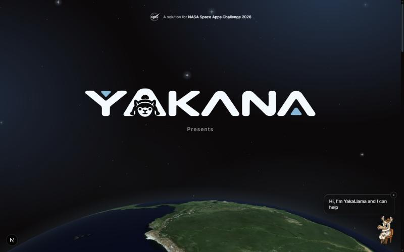
</p>

---

## Table of contents

1. [The problem](#1-the-problem)
2. [What we built](#2-what-we-built)
3. [Screens](#3-screens)
4. [Architecture](#4-architecture)
5. [The science in one page](#5-the-science-in-one-page)
6. [The prevention model](#6-the-prevention-model)
7. [Repository layout](#7-repository-layout)
8. [Quick start](#8-quick-start)
9. [Deployment and CI/CD](#9-deployment-and-cicd)
10. [Data sources, licenses and credits](#10-data-sources-licenses-and-credits)
11. [Team](#11-team)

---

## 1. The problem

NASA has watched fire from space for more than twenty years, but **two different cameras** did it:

| Sensor | Satellites | Pixel | Period |
| --- | --- | --- | --- |
| **MODIS** | Terra, Aqua | 1 km | 2000 → today |
| **VIIRS** | Suomi-NPP, NOAA-20, NOAA-21 | **375 m** | 2012 → today |

VIIRS sees much smaller fires, so it reports **about 4.8 times more hotspots than MODIS** over the same land and the same years. If you simply add the two records, fire seems to explode in 2012 — and again in 2018 when a second VIIRS satellite joins. That jump is a change of *camera*, not a change of *fire*.

> **The challenge:** harmonize MODIS and VIIRS into a single, honest, comparable record — and make it useful for people who are not scientists.

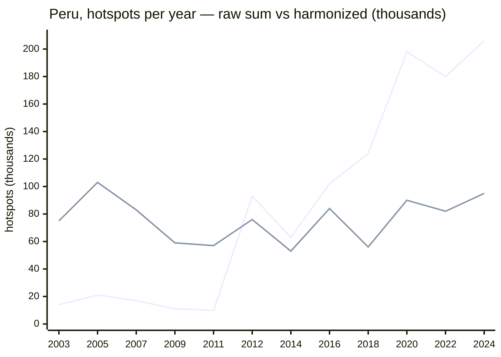

*Top line: MODIS + VIIRS added as they arrive. Bottom line: the harmonized series in VIIRS-equivalent hotspots. The ×8.9 jump of 2012 disappears once both are on one scale.*

---

## 2. What we built

**Yakana’s Fire Intelligence** is a full-stack product: a **backend** (data pipeline, prevention model and API) and a **frontend** (`frontend/`: six pages and an AI assistant, bilingual EN/ES).

| # | Page | Route | What it does |
| - | ---- | ----- | ------------ |
| 1 | **Story** | `/historia` | A scroll-driven 3D globe travels to Peru and shows **this week's real hotspots**, explains Costa / Sierra / Selva, and ends with the problem of the two satellites. |
| 2 | **Team** | `/equipo` | Photo cards that flip to show each person's contribution, with their social links. |
| 3 | **Method** | `/metodo` | The harmonization explained and *auditable*: before/after chart, and four tabs — try the model, validation, assumptions and limits, parameters by region. |
| 4 | **Explorer** | `/explorador` | Pick a region, a year and a month: summary, department map, **real 3D terrain with the real hotspot cells**, a 23-year monthly calendar, CSV export. |
| 5 | **Prevention** | `/prevencion` | *"Is there fire near you?"* — pick your home or farm and get a traffic-light answer, a map with 10 km / 25 km rings, a button to warn your family, and a **weather-style fire-risk forecast** (next 8 weeks or 14 days). |
| 6 | **Response** | `/respuesta` | For firefighters and authorities: active fires with coordinates, filters, CSV / GeoJSON export and a printable situation report. |
| – | **YakaLlama** | every page | The assistant. It knows the site, the team and the method, and can query the backend for real figures. |

Everything shown is **real data** from the team's API. Nothing is simulated or illustrative.

---

## 3. Screens

<table>
<tr>
<td width="50%"><b>Story — this week's fire over Peru</b><br>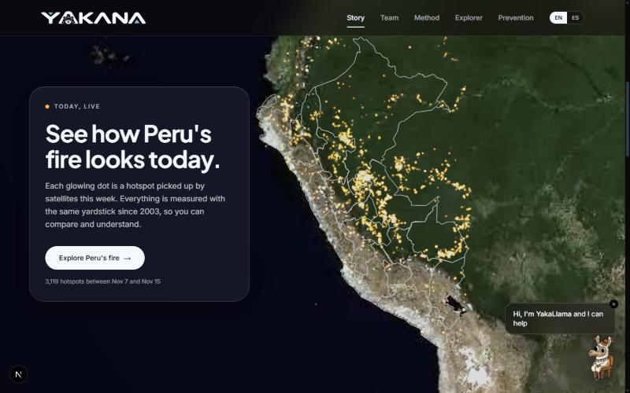</td>
<td width="50%"><b>Story — two satellites, two pictures</b><br>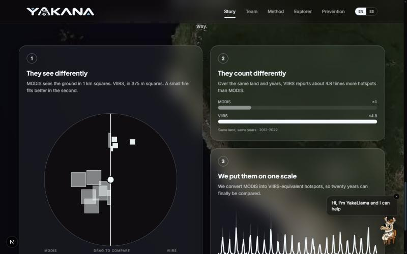</td>
</tr>
<tr>
<td><b>Method — try the model</b><br></td>
<td><b>Explorer — real hotspots on 3D terrain</b><br>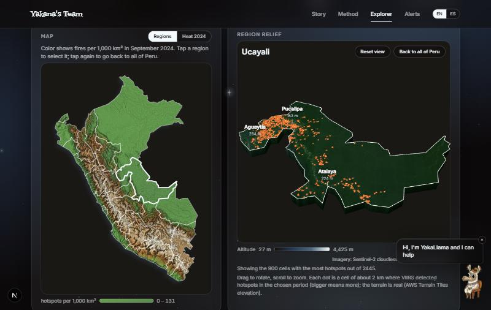</td>
</tr>
<tr>
<td><b>Explorer — 23-year monthly calendar</b><br>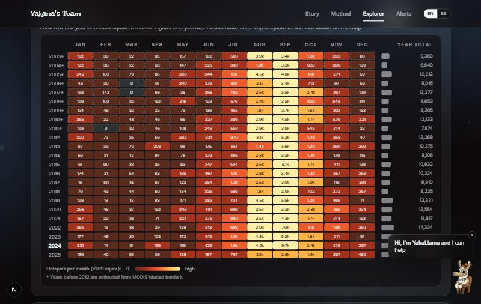</td>
<td><b>Explorer — all of Peru</b><br>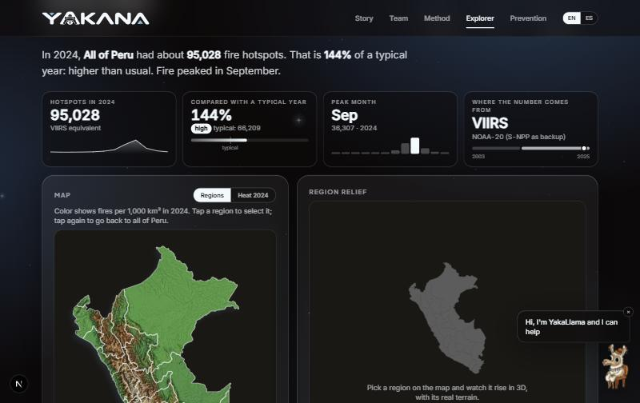</td>
</tr>
<tr>
<td><b>Prevention — is there fire near you?</b><br>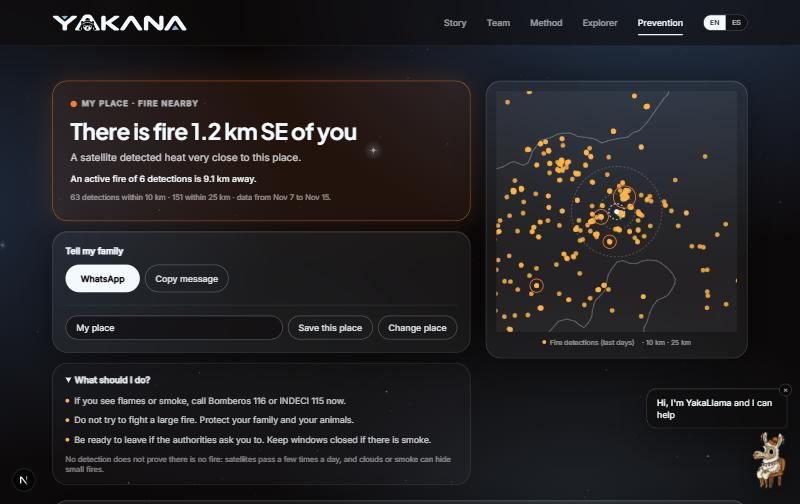</td>
<td><b>Prevention — the fire-risk forecast</b><br></td>
</tr>
<tr>
<td><b>Response — for firefighters and authorities</b><br>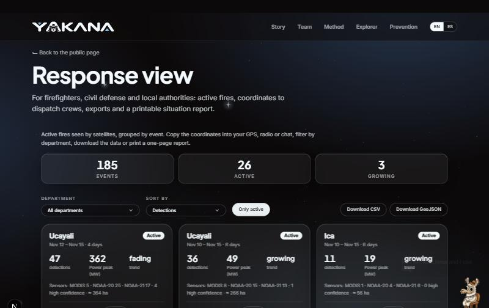</td>
<td><b>The team</b><br></td>
</tr>
</table>

---

## 4. Architecture

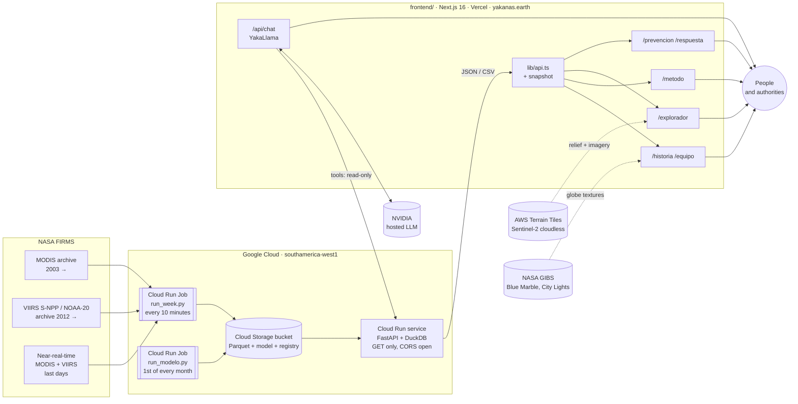

The container image is **one** image for the API and for the jobs (see [`backend/Dockerfile`](backend/Dockerfile)). The jobs and the API never share a disk: they exchange the data package through a **Cloud Storage bucket** (`DATOS_BUCKET`), and the API picks up newer files by itself.

### How a page gets its data

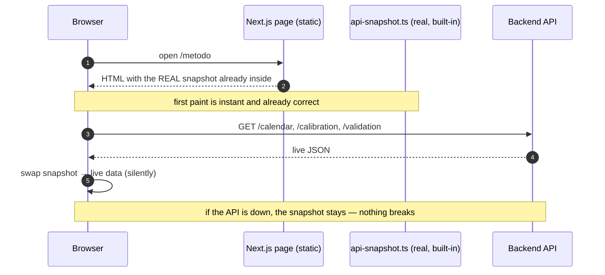

The **Method** and **Story** pages use this *snapshot-then-live* pattern. The **Explorer**, **Prevention** and **Response** pages always load live (with loading and retry states), because their numbers change.

### What each page asks the API

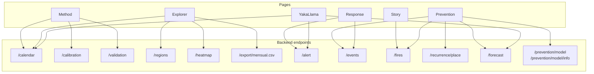

### Automatic updates

| What | How often | Who |
| --- | --- | --- |
| Recent-week hotspots and the harmonized series | **every 10 minutes** | Cloud Run Job `run_week.py` → bucket → API |
| Prevention model retraining | **on the 1st of every month** | Cloud Run Job `run_modelo.py` → bucket → API |
| The frontend's built-in snapshot | every day at 00:10 (Peru time) | GitHub Action [`daily-data.yml`](.github/workflows/daily-data.yml) → commit → Vercel redeploys |
| Live pages (Explorer, Prevention, Response, bot) | on every visit | straight from the API |

---

## 5. The science in one page

**One VIIRS satellite per day.** Adding satellites would inflate the series, so the pipeline keeps NOAA-20 (since April 2018), Suomi-NPP before that, and NOAA-21 only as a backup.

**Filters.** Vegetation fires only (`type = 0`) with nominal or high confidence; cells that were ever a volcano, a fixed source or sea are dropped. Local date (UTC−5), on a 0.02° grid (~5 km²).

**The model.** For each department, MODIS monthly totals are translated into VIIRS-equivalent hotspots with a log-log regression fitted on the years both satellites overlap (2012–2022):

```
log(V + 1) = a + d · high_season + b · log(M + 1)
V̂ = smear × e^(a + d·high + b·log(M+1)) − 1          (Duan smearing correction)
range = p10 … p90 of the model residuals
```

A department with fewer than 24 months with fire, fewer than 1 500 VIIRS hotspots in 2012–2022, or a slope `b` outside 0.5–1.3 uses the **national fit** instead.

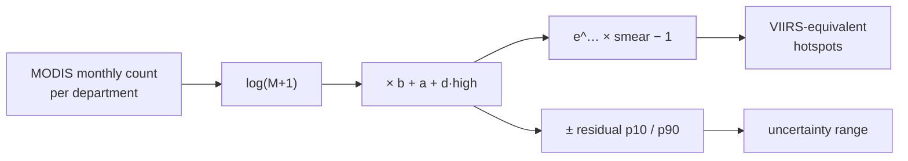

**Honest validation.** Trained on 2012–2019, tested on 2020–2022 (years the model never saw):

| Metric | Value |
| --- | --- |
| National monthly error | **≈ 13 %** |
| R² of the national monthly total | **0.94** |
| Real months inside the announced range | **63 %** |
| Average error per department and month | ≈ 24 % |
| Error by zone | Rainforest 18 % · Highlands 25 % · Coast 51 % (very little fire there) |

Full details live in [`backend/docs/metodo.md`](backend/docs/metodo.md) and [`backend/docs/API.md`](backend/docs/API.md).

---

## 6. The prevention model

The Prevention page answers a plain question — *how likely is fire around here, around this date?* — with a **logistic regression** trained on the harmonized series, built by the team's data scientist and compared against four other methods.

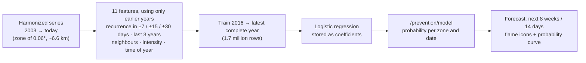

Tested on years the model had not seen (2019–2025):

| Method | Average precision | AUC | Zones marked that really burned | Fire anticipated |
| --- | --- | --- | --- | --- |
| Recurrence (plain history) | 0.571 | 0.857 | 83.0 % | 28.1 % |
| **Logistic regression (served)** | **0.637** | **0.893** | **83.7 %** | **28.4 %** |
| Random forest | 0.641 | 0.894 | 84.4 % | 28.6 % |
| Gradient boosting | 0.638 | 0.893 | 84.1 % | 28.5 % |

The simple model was chosen on purpose: it performs like the complex ones, gives real probabilities between 0 and 1, and its weights can be read. It ranks zones better than plain history; it marks them right about as often. **It uses no weather**, so the website says it is a prediction from past years, not a warning of a specific fire. The job `run_modelo.py` retrains it every month. See [`backend/docs/modelo-predictivo.md`](backend/docs/modelo-predictivo.md).

---

## 7. Repository layout

```
Yakanas-NASA/
├─ README.md                  ← you are here (project overview)
├─ docs/
│  └─ images/                 ← screenshots and the banner used in the READMEs
├─ .github/workflows/
│  └─ daily-data.yml          ← daily refresh of the frontend's data snapshot
├─ frontend/                  ← Next.js app (see frontend/README.md)
│  ├─ src/app/                  routes: historia, equipo, metodo, explorador,
│  │                            prevencion, respuesta, api/chat
│  ├─ src/components/           shared UI + per-page components
│  ├─ src/lib/                  API client, i18n, data hooks, snapshot
│  ├─ scripts/                  snapshot-api.mjs
│  └─ public/                   images, textures, official brand SVGs, team photos
└─ backend/                   ← API + pipeline + model (see backend/README.md)
   ├─ app/                      FastAPI routes, storage sync, prevention model
   ├─ ingest/                   FIRMS downloads
   ├─ harmonize/                the harmonization and the series build
   ├─ run_serie.py              build the series (once)
   ├─ run_week.py               refresh the recent week  (Cloud Run Job)
   ├─ run_modelo.py             retrain the prevention model  (Cloud Run Job)
   ├─ data/out/                 small results kept in git
   └─ docs/                     API.md, metodo.md, modelo-predictivo.md
```

| Folder | Docs |
| --- | --- |
| `frontend/` | [`frontend/README.md`](frontend/README.md) |
| `backend/` | [`backend/README.md`](backend/README.md) |

---

## 8. Quick start

You only need **Node.js 20+** to run the website; it talks to the already-deployed API.

```bash
git clone https://github.com/SebasHuaypar/Yakanas-NASA.git
cd Yakanas-NASA/frontend
npm install
npm run dev          # http://localhost:3000  →  redirects to /historia
```

Other commands: `npm run build` (production build), `npm run lint`, `npx tsc --noEmit`.

To point the site at another API (for example a local one), or to turn on the assistant, copy the example env file:

```bash
cp .env.example .env.local   # NEXT_PUBLIC_API_URL=https://… (no trailing slash)
                             # NVIDIA_API_KEY=…   (server only, enables YakaLlama)
```

To run the **backend** locally (Python or Docker, needs a free FIRMS key) follow [`backend/README.md`](backend/README.md).

---

## 9. Deployment and CI/CD

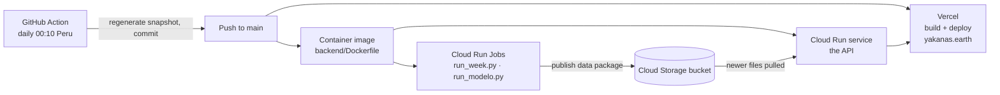

| Piece | Where | Notes |
| --- | --- | --- |
| **Frontend** | Vercel, domain [`yakanas.earth`](https://yakanas.earth) (and `www`) | Set **Root Directory = `frontend`**. Env vars: `NEXT_PUBLIC_API_URL` (optional), `NVIDIA_API_KEY` (server only, for YakaLlama) and `NVIDIA_MODEL` (optional). |
| **Backend API** | Google Cloud Run service (`southamerica-west1`) | Container built from `backend/Dockerfile`. Reads the data package from the bucket and reloads it when a newer one appears. |
| **Recurring jobs** | Google Cloud Run **Jobs**, same image | `python run_week.py` queries NASA FIRMS and refreshes the recent week **every 10 minutes**; `python run_modelo.py` retrains the prevention model **on the 1st of every month**. Both publish to the bucket (`DATOS_BUCKET`) because a job's disk is wiped when it ends. |
| **Data snapshot** | GitHub Actions · [`daily-data.yml`](.github/workflows/daily-data.yml) | Every day at 00:10 (Peru) it regenerates `frontend/src/lib/api-snapshot.ts` and, if it changed, commits it to `main`; Vercel then redeploys. Can also be run by hand. |

Notes:

- When the API moves to another address, **only `NEXT_PUBLIC_API_URL` changes** — no code.
- On Vercel's Hobby plan a deployment is blocked when the last commit's author is not a member of the team; the daily Action therefore commits with the repository owner's identity.
- The assistant's key lives **only on the server** (never `NEXT_PUBLIC_`), and the chat route rate-limits requests by IP.

---

## 10. Data sources, licenses and credits

| Data | Source | License / terms |
| --- | --- | --- |
| Fire hotspots | [NASA FIRMS](https://firms.modaps.eosdis.nasa.gov/) (MODIS C6.1, VIIRS 375 m) | NASA open data |
| Globe textures | NASA GIBS: Blue Marble, VIIRS City Lights | Public domain |
| Terrain elevation | AWS Open Data · Terrain Tiles (Terrarium) | Open |
| Satellite imagery in 3D | Sentinel-2 cloudless © [EOX](https://s2maps.eu) | CC BY-NC-SA 4.0 (credit shown on screen) |
| Department boundaries | geoBoundaries | CC BY |
| Place names | GeoNames | CC BY 4.0 |
| Place search | OpenStreetMap Nominatim | ODbL |
| Assistant language model | NVIDIA hosted models (build.nvidia.com) | NVIDIA API terms |
| Fonts | Plus Jakarta Sans (titles), Inter (body) | SIL OFL |

The NASA logo is used only to name the challenge; it does not imply NASA's endorsement.

---

## 11. Team

Built by **Yakana's Team** for the NASA Space Apps Challenge 2026.

| Person | Role | Contribution |
| --- | --- | --- |
| **Sebastián Huaypar** | Project Manager & Team Lead | Led the project end to end; visual identity and design system; Story, Prevention, Response and Team pages; EN/ES; data integration; daily data automation and deployment. |
| **Giordano Medrano** | Frontend Developer | Method page; the official logotype and isotype. |
| **Darcy Ortega** | Full-stack Developer | Explorer (map, 3D relief, calendar); the YakaLlama assistant; the pitch video. |
| **Cesar Correa** | Backend Lead | The API (historical series, live week, prevention model) and its deployment on Google Cloud. |
| **Isabel Makishi** | Data Engineer | Ingestion pipeline, MODIS–VIIRS harmonization, data quality, monthly retraining. |
| **Isaac Martel** | Data Scientist | The predictive (logistic regression) model and its comparison with four other methods. |

