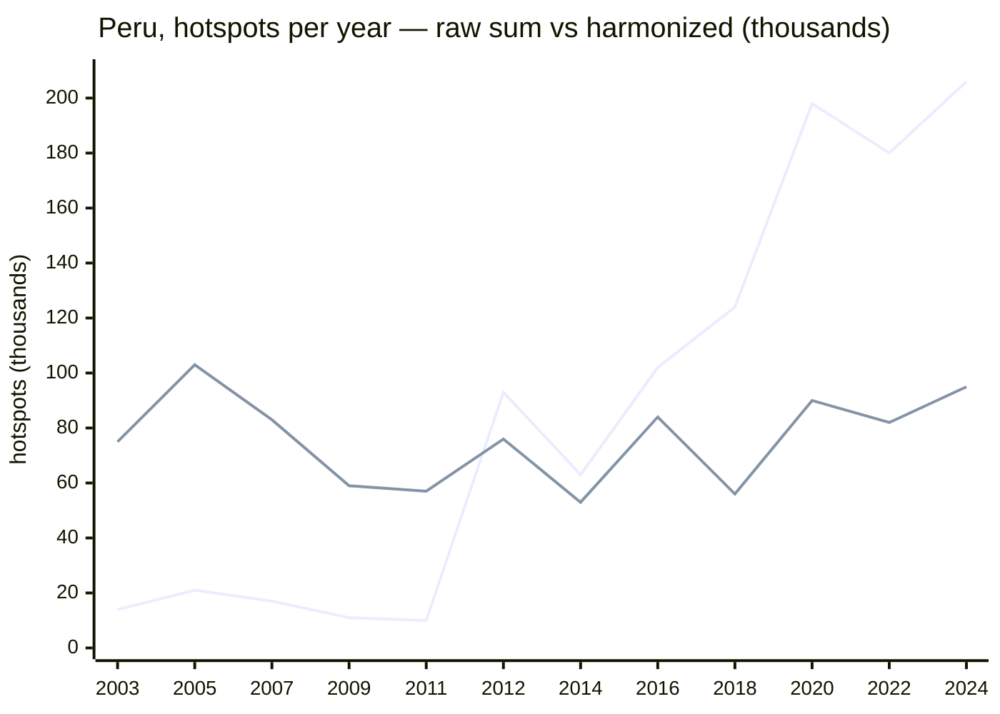
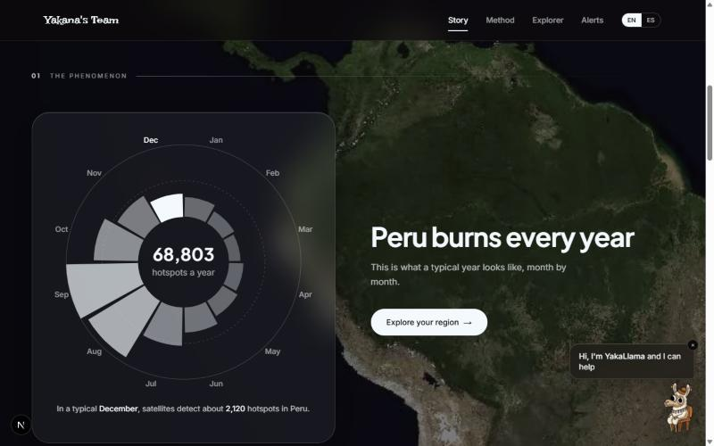
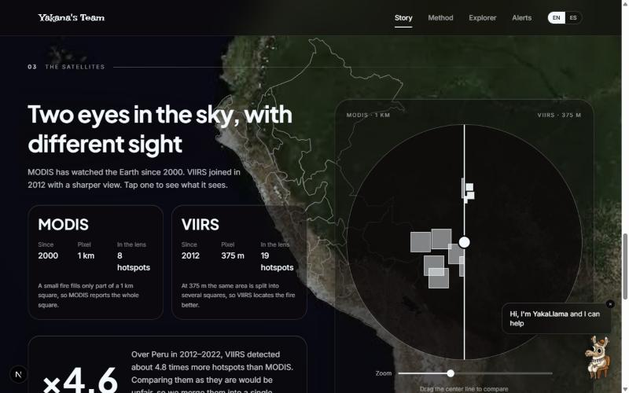
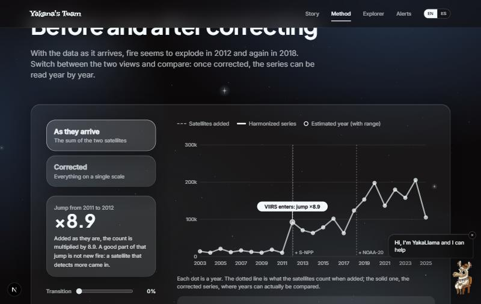
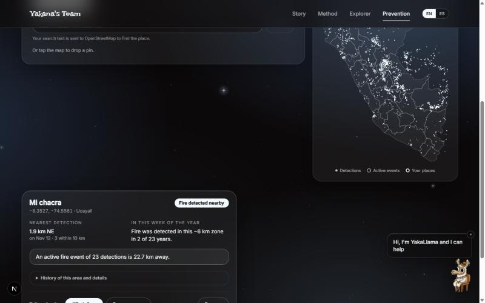
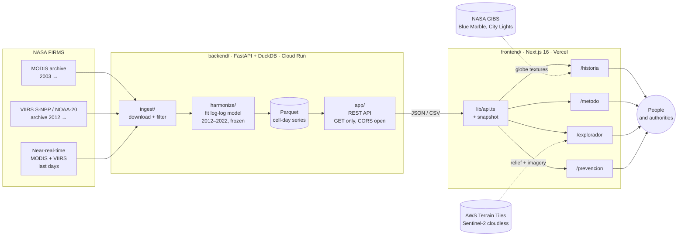
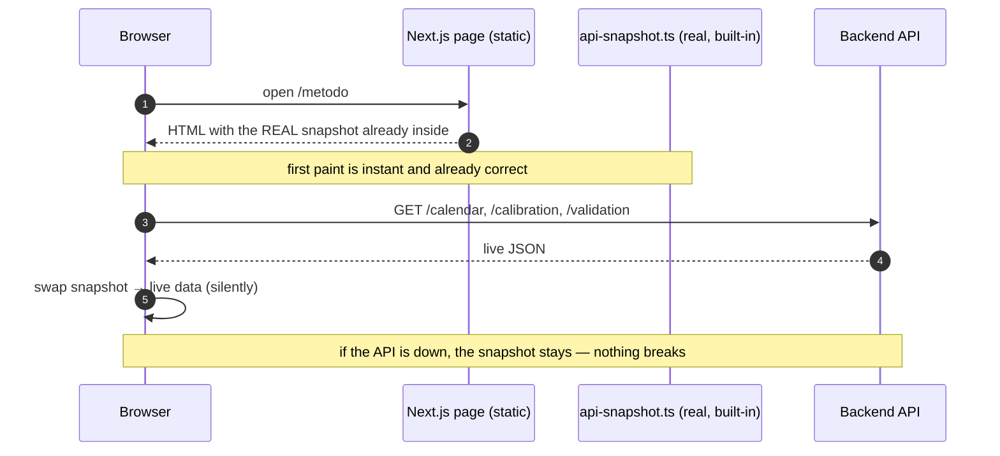
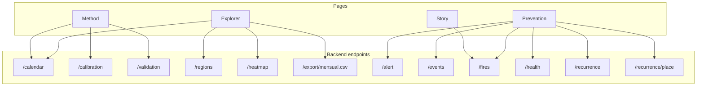
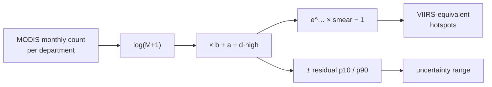

<div align="center">

# Yakana's Team · Fire Calendar of Peru

**One comparable record of Peru's satellite fire hotspots, 2003 → today — harmonized across NASA's MODIS and VIIRS sensors, explored on the web and turned into alerts.**

*NASA Space Apps Challenge 2026 · Lima*


</div>

---

## Table of contents

1. [The problem](#1-the-problem)
2. [What we built](#2-what-we-built)
3. [Screens](#3-screens)
4. [Architecture](#4-architecture)
5. [The science in one page](#5-the-science-in-one-page)
6. [Repository layout](#6-repository-layout)
7. [Quick start](#7-quick-start)
8. [Deployment](#8-deployment)
9. [Data sources, licenses and credits](#9-data-sources-licenses-and-credits)
10. [Team](#10-team)

---

## 1. The problem

NASA has watched fire from space for more than twenty years, but **two different cameras** did it:

| Sensor | Satellites | Pixel | Period |
| --- | --- | --- | --- |
| **MODIS** | Terra, Aqua | 1 km | 2000 → today |
| **VIIRS** | Suomi-NPP, NOAA-20, NOAA-21 | **375 m** | 2012 → today |

VIIRS sees much smaller fires, so it reports **about 4.8 times more hotspots than MODIS** over the same land and the same years. If you simply add the two records, fire seems to explode in 2012 — and again in 2018 when a second VIIRS satellite joins. That jump is a change of *camera*, not a change of *fire*.

> **The challenge:** harmonize MODIS and VIIRS into a single, honest, comparable record — and make it useful for people who are not scientists.



*Top line: MODIS + VIIRS added as they arrive. Bottom line: the harmonized series in VIIRS-equivalent hotspots. The ×8.9 jump of 2012 disappears once both are on one scale.*

---

## 2. What we built

A full-stack product with a **backend** (data pipeline + API, built by the backend team) and a **frontend** (this repo's `frontend/`: four pages, bilingual EN/ES).

| # | Page | Route | What it does |
| - | ---- | ----- | ------------ |
| 1 | **Story** | `/historia` | A scroll-driven 3D globe travels to Peru, a "fire clock" shows a typical year, a real MODIS-vs-VIIRS lens shows why the cameras disagree, and an animated chart shows how we merge them. |
| 2 | **Method** | `/metodo` | The harmonization explained and *auditable*: before/after chart, validation on years the model never saw, per-region parameters, an interactive simulator of the formula. |
| 3 | **Explorer** | `/explorador` | Pick a region, a year and a month: summary, department map, **real 3D terrain with the real hotspot cells**, a 23-year monthly calendar, CSV export. |
| 4 | **Prevention** | `/prevencion` | For families, farmers, firefighters and authorities: check *your places* against nearby fire, copy field coordinates and print a situation report, and see where fire usually appears this time of year. |
| – | **YakaLlama** | every page | Floating chatbot mascot (UI ready, answers coming soon). |

Everything shown is **real data** from the team's API. Nothing is simulated or illustrative.

---

## 3. Screens

<table>
<tr>
<td width="50%"><b>Story — the typical year</b><br></td>
<td width="50%"><b>Story — two eyes in the sky</b><br></td>
</tr>
<tr>
<td><b>Method — before and after correcting</b><br></td>
<td><b>Explorer — real hotspots on 3D terrain</b><br></td>
</tr>
<tr>
<td><b>Explorer — 23-year monthly calendar</b><br></td>
<td><b>Prevention — my places</b><br></td>
</tr>
</table>

---

## 4. Architecture



### How a page gets its data



The **Method** and **Story** pages use this *snapshot-then-live* pattern. The **Explorer** and **Prevention** pages always load live (with loading and retry states), because their numbers change.

### What each page asks the API



---

## 5. The science in one page

**One VIIRS satellite per day.** Adding satellites would inflate the series, so the pipeline keeps NOAA-20 (since April 2018), Suomi-NPP before that, and NOAA-21 only as a backup.

**Filters.** Vegetation fires only (`type = 0`) with nominal or high confidence; cells that were ever a volcano, a fixed source or sea are dropped. Local date (UTC−5), on a 0.02° grid (~5 km²).

**The model.** For each department, MODIS monthly totals are translated into VIIRS-equivalent hotspots with a log-log regression fitted on the years both satellites overlap (2012–2022):

```
log(V + 1) = a + d · high_season + b · log(M + 1)
V̂ = smear × e^(a + d·high + b·log(M+1)) − 1          (Duan smearing correction)
range = p10 … p90 of the model residuals
```

A department with fewer than 24 months with fire, fewer than 1 500 VIIRS hotspots in 2012–2022, or a slope `b` outside 0.5–1.3 uses the **national fit** instead.



**Honest validation.** Trained on 2012–2019, tested on 2020–2022 (years the model never saw):

| Metric | Value |
| --- | --- |
| National monthly error | **≈ 13 %** |
| R² of the national monthly total | **0.94** |
| Real months inside the announced range | **63 %** |
| Average error per department and month | ≈ 24 % |
| Error by zone | Rainforest 18 % · Highlands 25 % · Coast 51 % (very little fire there) |

The seasonal history page is validated too: zones that had fire in 60–80 % of past years actually burned about **85 %** of the time in the 2019–2025 tests (the API's own back-test).

Full details live in [`backend/docs/metodo.md`](backend/docs/metodo.md) and [`backend/docs/API.md`](backend/docs/API.md).

---

## 6. Repository layout

```
Yakanas-NASA/
├─ README.md                  ← you are here (project overview)
├─ docs/
│  └─ images/                 ← screenshots used in the READMEs
├─ frontend/                  ← Next.js app (see frontend/README.md)
│  ├─ src/app/                  routes: historia, metodo, explorador, prevencion
│  ├─ src/components/           shared UI + per-page components
│  ├─ src/lib/                  API client, i18n, data hooks, snapshot
│  ├─ scripts/                  snapshot-api.mjs
│  └─ public/                   images, textures, icons
└─ backend/                   ← API + pipeline (owned by the backend team; see backend/README.md)
   ├─ app/                      FastAPI routes
   ├─ ingest/                   FIRMS downloads
   ├─ harmonize/                the model and the series build
   ├─ data/out/                 small results kept in git
   ├─ docs/                     API.md, metodo.md
   └─ web/                      their own reference pages
```

| Folder | Owner | Docs |
| --- | --- | --- |
| `frontend/` | Frontend team | [`frontend/README.md`](frontend/README.md) |
| `backend/` | Backend team | [`backend/README.md`](backend/README.md) |

---

## 7. Quick start

You only need **Node.js 20+** to run the website; it talks to the already-deployed API.

```bash
git clone https://github.com/SebasHuaypar/Yakanas-NASA.git
cd Yakanas-NASA/frontend
npm install
npm run dev          # http://localhost:3000  →  redirects to /historia
```

Other commands: `npm run build` (production build), `npm run lint`, `npx tsc --noEmit`.

To point the site at another API (for example a local one), copy the example env file:

```bash
cp .env.example .env.local   # NEXT_PUBLIC_API_URL=https://… (no trailing slash)
```

To run the **backend** locally (Python or Docker, needs a free FIRMS key) follow [`backend/README.md`](backend/README.md).

---

## 8. Deployment

| Piece | Where | Notes |
| --- | --- | --- |
| **Frontend** | Vercel | Set **Root Directory = `frontend`**. Optional env var `NEXT_PUBLIC_API_URL`. The build is fully static. |
| **Backend API** | Google Cloud Run (`southamerica-west1`) | Container built from `backend/Dockerfile`. |

When the API moves to its final address, **only `NEXT_PUBLIC_API_URL` changes** — no code.

---

## 9. Data sources, licenses and credits

| Data | Source | License / terms |
| --- | --- | --- |
| Fire hotspots | [NASA FIRMS](https://firms.modaps.eosdis.nasa.gov/) (MODIS C6.1, VIIRS 375 m) | NASA open data |
| Globe textures | NASA GIBS: Blue Marble, VIIRS City Lights | Public domain |
| Terrain elevation | AWS Open Data · Terrain Tiles (Terrarium) | Open |
| Satellite imagery in 3D | Sentinel-2 cloudless © [EOX](https://s2maps.eu) | CC BY-NC-SA 4.0 (credit shown on screen) |
| Department boundaries | geoBoundaries | CC BY |
| Place names | GeoNames | CC BY 4.0 |
| Fonts | Irish Grover (logo), Plus Jakarta Sans (titles), Inter (body) | SIL OFL |

The NASA logo is used only to name the challenge; it does not imply NASA's endorsement.

---

## 10. Team

Built by **Yakana's Team**: Darcy Ortega · Sebastián Huaypar · Giordano Medrano · Isabel Makishi · Cesar Correa · Isaac Martel.

- **Frontend:** Sebastián Huaypar (Story page, shared design system, global language system, Prevention, data integration), Giordano Medrano (Method page), Darcy Ortega (Explorer).
- **Backend and data:** Cesar Correa and team (pipeline, model, API).

