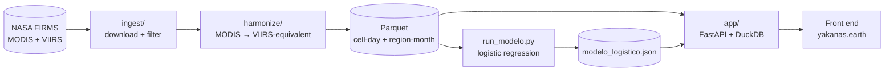
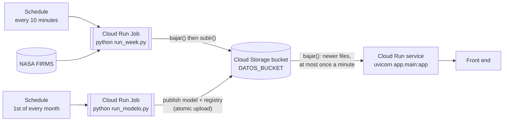

# Fire Calendar · backend

The data pipeline, the prevention model and the API behind **Yakana’s Fire Intelligence** ([yakanas.earth](https://yakanas.earth)).

Peru fire hotspots from NASA FIRMS, MODIS and VIIRS, as one comparable series from 2003 to today. A small FastAPI app serves the data, three static pages show it, and a logistic regression turns the history into a fire-risk probability for the prevention page.

Before 20 January 2012 the series is MODIS converted to VIIRS-equivalent hotspots. From that date it is observed VIIRS, one satellite per day. The conversion is fit on 2012–2022 and frozen. On the held-out years 2020–2022 the national error is about 13 %.



## Where things are

| Path | What it is |
|---|---|
| `app/`, `ingest/`, `harmonize/`, `tests/` | The API, the downloads, the harmonization and the tests |
| `app/modelo.py` | The prevention model: the features (shared by training and the API) and the evaluation with numpy |
| `app/almacen.py` | Copies the data package to a Cloud Storage bucket and pulls it back when the copy there is newer |
| `run_serie.py` | Builds the harmonized series, 2003 to today (once) |
| `run_week.py` | Downloads and appends the recent week (**Cloud Run Job**, every 10 minutes) |
| `run_modelo.py` | Retrains the logistic regression the API serves (**Cloud Run Job**, on the 1st of every month) |
| `comparar_modelos.py` | Compares five prediction methods. Evidence only; nothing serves it |
| `data/out/` | Small results kept in git: calibration, validation, model, summaries |
| `web/` | The three pages |
| `Dockerfile`, `docker-compose.yml` | One image for the API, the pages and the jobs |
| `.gcloudignore` | What `gcloud run deploy --source` does **not** upload (the git-ignored series files must still go up) |

## What you need

- Docker Desktop, **or** Python 3.11 or newer
- A FIRMS MAP key ([request one here](https://firms.modaps.eosdis.nasa.gov/api/area/)), needed to download 2026 and the recent week

Put the key in `.env`, which git ignores:

```bash
cp .env.example .env
```

```
FIRMS_MAP_KEY=your_key
```

## Run with Docker

From this folder (`backend/`):

```bash
docker compose run --rm serie      # once: builds the series, 2003 to today
docker compose run --rm semana     # optional: downloads the recent week
docker compose up -d --build       # API on :8000, pages on :5500
```

There is no database container: the series lives in Parquet files and DuckDB reads them. `data` and `web` are mounted as volumes, so data and page edits show up without rebuilding the image.

Stop any local `uvicorn` first, because it uses the same port.

## Run without Docker

```bash
python3 -m venv .venv
.venv/bin/pip install -r requirements.txt
.venv/bin/python run_serie.py      # once: builds the series, 2003 to today
.venv/bin/python run_week.py       # optional: downloads the recent week
.venv/bin/pip install -r requirements-modelo.txt
.venv/bin/python run_modelo.py     # optional: trains the prevention model (/prevention/model)
.venv/bin/uvicorn app.main:app --host 127.0.0.1 --port 8000
```

In a second terminal:

```bash
cd web
python3 -m http.server 5500 --bind 127.0.0.1
```

On Windows the interpreter is `.venv\Scripts\python`.

## Open it

| Page | URL |
|---|---|
| Harmonized series: alert, calendar, chart, map | http://127.0.0.1:5500/armonizado.html |
| Prevention: where fire tends to come back around a date | http://127.0.0.1:5500/prevencion.html |
| Week radar: raw detections grouped into events, alert and forecast | http://127.0.0.1:5500/radar.html |
| Story page | http://127.0.0.1:5500/calendario-del-fuego.html |
| Recent-week checker | http://127.0.0.1:5500/comprobar-api.html |
| API docs | http://127.0.0.1:8000/docs |

The story page tells the story with a 2003–2025 series embedded in the file and an earlier in-browser conversion. Its numbers can differ slightly from the API. For figures, use the harmonized series.

## What the data commands do

**`run_serie.py`** downloads the country CSV files for 2003–2025 once (files already in `data/raw/sp/` are reused), downloads 2026 from the FIRMS API, fits the calibration and writes:

| Path | What it is | In git |
|---|---|---|
| `data/raw/` | FIRMS CSV files | No |
| `data/processed/fire_cell_day.parquet` | Hotspots per 0.02° cell and day | No |
| `data/processed/region_month.parquet` | Monthly totals per department | No |
| `data/out/calibration_factors.csv` | Conversion coefficients per department | Yes |
| `data/out/validation.json` | Errors on 2020–2022 | Yes |
| `data/out/armonizado.json` | Coverage summary, with the last day included | Yes |
| `data/out/regiones.json` | Department ids and names | Yes |
| `data/out/recurrencia_validacion.json` | How often the prevention map was right on 2019–2025 | Yes |

The Parquet files are not in git, so a fresh clone has to run this command once before the series routes answer. For 2026, January–July come from the standard product and August onward from the near-real-time feed.

**`run_week.py`** downloads the last 8 days (MODIS, NOAA-20, NOAA-21), appends them to the series and writes `data/parquet/fires.parquet` plus `week.json`, `heat.json`, `series.json` and `meta.json` in `data/out/`. The recent-week routes, the radar and the checker page read it. Without it they fall back to the 7–14 November 2026 week kept in `data/out/fires.csv`. The days already downloaded are kept.

**`run_modelo.py`** retrains the logistic regression that `/prevention/model` serves. It reads `fire_cell_day.parquet` (the harmonized output), builds the training table using only dates whose ±15-day window is already closed, trains, and writes `data/out/modelo_logistico.json` plus a line in `data/out/reentrenamientos.jsonl` (the registry of retrainings). It does not compare other methods and does not touch the harmonization. It runs on the 1st of every month, so the model learns the newest fire.

**`comparar_modelos.py`** compares five methods (recurrence, linear and logistic regression, random forest, gradient boosting) on 2019–2025 with years they had not seen and writes `data/out/modelos_comparacion.json`. Nothing schedules it: it is the evidence behind choosing the logistic regression, and the file that exists is kept as it is.

## The prevention model

`GET /prevention/model` gives each 0.06° zone (about 6.6 km) a probability of fire within 15 days of a date. It is a logistic regression over 11 features computed from earlier years only: recurrence in ±7, ±15 and ±30 days, the last three years, whether it burned last year, years since the last fire, the recurrence of the 8 neighbouring zones, the year-round recurrence, the mean intensity and the time of year. `GET /prevention/model/info` returns the weights, the date of the last retraining and the validation on years the model had not seen.

| On 2019–2025 | Average precision | AUC | Marked zones that burned | Fire anticipated |
|---|---|---|---|---|
| Recurrence | 0.571 | 0.857 | 83.0 % | 28.1 % |
| **Logistic regression** | **0.637** | **0.893** | **83.7 %** | **28.4 %** |

It ranks zones better than plain recurrence and marks them right about as often. It uses no weather. `/recurrence` is untouched and stays as the fallback. The model is stored as coefficients, so the API needs numpy only: scikit-learn is used by the training job, not by the service.

## Cloud Run: the service, the jobs and the bucket

The same image (`Dockerfile`) runs everything on Google Cloud. A job's disk is wiped when the job ends, so the API and the jobs exchange the data package through a **Cloud Storage bucket**, set with the `DATOS_BUCKET` variable. Without it everything stays on disk, which is what happens locally.



| Piece | What it runs | What it does |
|---|---|---|
| **Service** | `uvicorn app.main:app` | Serves the API. Pulls newer files from the bucket at most once a minute and reloads the model at most every five minutes, so a retraining shows up without a redeploy. |
| **Job `run_week`** | `python run_week.py` | Pulls the package, downloads the recent week, rebuilds the affected days and pushes the package back to the bucket. |
| **Job `run_modelo`** | `python run_modelo.py` | Pulls the package, retrains, and publishes `modelo_logistico.json` and `reentrenamientos.jsonl`. Uploads are atomic (written under a temporary name, then renamed), so the API never reads a half-written model. |

What the package holds (`app/almacen.py`): the Parquet files, `meta.json`, `week.json`, `fires.csv`, the model and the registry. Credentials come from the Cloud Run service account; if `DATOS_BUCKET` is set and there are none, a job stops with a clear error instead of silently keeping the data on a disk that will be wiped.

| Variable | Where | What it does |
|---|---|---|
| `FIRMS_MAP_KEY` | jobs, local runs | Key to download 2026 and the recent week |
| `DATOS_BUCKET` | service and jobs | Name of the bucket that shares the data package |
| `PORT` | service | Port to listen on (Cloud Run sets it; default 8000) |

Deploy the service from this folder with `gcloud run deploy --source .`; `.gcloudignore` makes sure the files git ignores but the API needs are uploaded.

## Tests

```bash
.venv/bin/pip install pytest
.venv/bin/python -m pytest tests          # harmonization, regions, alert, events, forecast, recurrence, prevention model
.venv/bin/python tests/comprobar.py       # checks the downloaded week; needs run_week.py first
```

`tests/test_modelo_ml.py` checks that the model's features never see the year being predicted.

## Known limits

- The alert rule has not been tested against past years. Treat it as a signal to look at.
- The most recent days come from the near-real-time feed and can be incomplete.
- The forecast (`/forecast`) is a seasonal baseline: the typical value of each month. Tested on 2019–2025 it was off by about 39 % per department and month, and it does not anticipate exceptional years.
- The prevention map (`/recurrence`) is history that repeats, with no weather in it. It counts 2003–2011 from MODIS and 2012 onward from VIIRS, once per year. MODIS misses small fires, so those early years lower the frequency. Tested on 2019–2025, zones with fire in 7 of 10 years or more burned 93 % of the time, and they held 13 % of the zones that burned.
- The prevention model (`/prevention/model`) ranks zones better than that history but it covers only about 28 % of the fire and uses no rain, drought or wind. Present it as the likelihood of fire here around this date, from past years — not as the chance of a particular wildfire.
- Events (`/events`) describe what the satellites saw. They do not predict where a fire will move, and their area is a ceiling from pixel sizes, not burned area.
- The data refreshes with the jobs above; running `serie` or `semana` again does it by hand.
- Only Peru is covered.
