<div align="center">


# Frontend · Yakana’s Fire Intelligence

</div>

The website of **Yakana’s Fire Intelligence** ([yakanas.earth](https://yakanas.earth)): six bilingual (EN/ES) pages and an AI assistant that explain, explore and help people act on Peru's satellite fire hotspots, harmonized across NASA's MODIS and VIIRS sensors.

> Project overview, the science and the full architecture are in the [root README](../README.md). This document is about **how the frontend is built and how to work on it**.


---

## Contents

1. [Quick start](#1-quick-start)
2. [Tech stack](#2-tech-stack)
3. [Pages](#3-pages)
4. [Architecture](#4-architecture)
5. [Data layer](#5-data-layer)
6. [Internationalization](#6-internationalization)
7. [Design system](#7-design-system)
8. [The 3D region view](#8-the-3d-region-view)
9. [Performance](#9-performance)
10. [Responsive and accessibility](#10-responsive-and-accessibility)
11. [Project structure](#11-project-structure)
12. [Recipes: how to extend it](#12-recipes-how-to-extend-it)
13. [Conventions and workflow](#13-conventions-and-workflow)
14. [Deployment and automation](#14-deployment-and-automation)
15. [Troubleshooting](#15-troubleshooting)

---

## 1. Quick start

Requirements: **Node.js 20.9+** and npm. No backend needed — the site calls the deployed API.

```bash
cd frontend
npm install
npm run dev          # http://localhost:3000  → redirects to /historia
```

| Command | What it does |
| --- | --- |
| `npm run dev` | Dev server (Turbopack) on :3000 |
| `npm run build` | Production build (everything is prerendered statically) |
| `npm start` | Serve the production build |
| `npm run lint` | ESLint (includes the React Hooks and React Compiler rules) |
| `npx tsc --noEmit` | Type-check |
| `node scripts/snapshot-api.mjs` | Regenerate [`src/lib/api-snapshot.ts`](src/lib/api-snapshot.ts) from the live API |

**Environment** — all variables are optional:

```bash
cp .env.example .env.local
```

| Variable | Scope | What it does |
| --- | --- | --- |
| `NEXT_PUBLIC_API_URL` | browser | Address of the backend API (no trailing slash). Without it the site uses the current deployment. When the API moves, **this is the only line that changes**. |
| `NVIDIA_API_KEY` | **server only** | Key for the YakaLlama assistant ([build.nvidia.com](https://build.nvidia.com)). Never prefix it with `NEXT_PUBLIC_`. Without it the chat shows "not set up yet". |
| `NVIDIA_MODEL` | server only | Optional: another NVIDIA model for the assistant. |

> ⚠️ This project uses a very recent Next.js (16). Read [`AGENTS.md`](AGENTS.md) and the docs inside `node_modules/next/dist/docs/` before relying on older conventions.

---

## 2. Tech stack

| Area | Choice | Why |
| --- | --- | --- |
| Framework | **Next.js 16** (App Router, Turbopack, `cacheComponents`) | Static prerender + client islands, plus one server route for the assistant |
| UI | **React 19.3**, **TypeScript** | Types for every API response |
| Styling | **Tailwind CSS 4** (`@theme inline`, `@layer base`) | Design tokens as CSS variables, no CSS files per component |
| 3D | **three.js** + **@react-three/fiber** | Day/night globe with live hotspots, relief terrain with hotspot cells |
| Motion | **motion** (Framer Motion successor) | Reveal and chart animations in the Method page |
| Charts | Hand-written **SVG** | Full control, tiny bundle, accessible |
| Data | `fetch` + a small typed client | No heavy data library needed |
| Assistant | Route handler `app/api/chat` + NVIDIA hosted model | The key stays on the server; read-only tools query the backend |

---

## 3. Pages

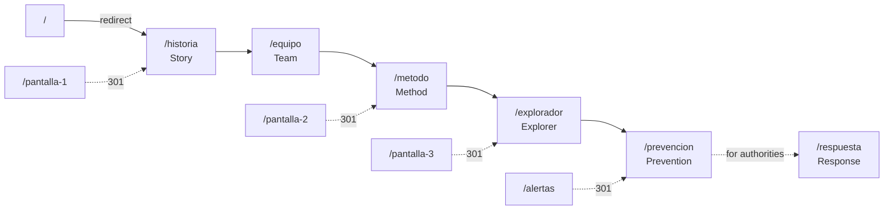

Old working names (`/pantalla-N`, `/alertas`) permanently redirect, so shared links keep working (see [`next.config.ts`](next.config.ts)). `/respuesta` is linked from Prevention rather than from the navbar.

### 3.1 Story — `/historia`

A narrative landing page driven by scroll. The globe is real: it shows **the last week's hotspots over Peru**.

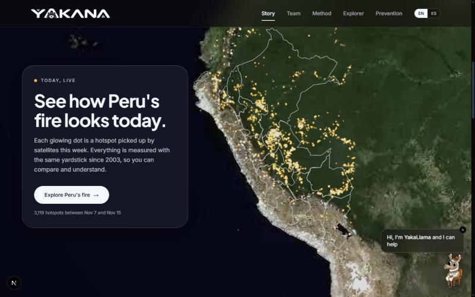

| Section | Component | Data |
| --- | --- | --- |
| Hero + globe | [`HeroScroll`](src/components/hero/HeroScroll.tsx), [`GlobeScene`](src/components/hero/GlobeScene.tsx) | NASA GIBS textures; a custom GLSL shader blends day/night and the globe travels to Peru. The title is the official logotype. |
| 01 Today, live | [`LiveSection`](src/components/hero/LiveSection.tsx) | **Live** `/fires`: every detection of the week becomes a glowing ember→amber dot on the globe (second shader), with a call to action to the Explorer. |
| 02 Costa, Sierra, Selva | [`Regions`](src/components/sections/Regions.tsx), [`RegionCard`](src/components/hero/RegionCard.tsx) | Typical year of each of Peru's three natural regions |
| 03 The problem | [`Satellites`](src/components/sections/Satellites.tsx), [`PixelLens`](src/components/sections/PixelLens.tsx) | Three short ideas — they see differently, count differently, we put them on one scale — with a real MODIS-vs-VIIRS lens and a call to action to Method |

The globe is a fixed, sticky layer behind the page. Sections talk to it through a tiny shared object, [`sceneBus`](src/lib/scene-bus.ts) (`outline`, `zoom`, `clear`, `hot`, `points`, `pointsVersion`), instead of React state — the scene reads it every frame without re-rendering.

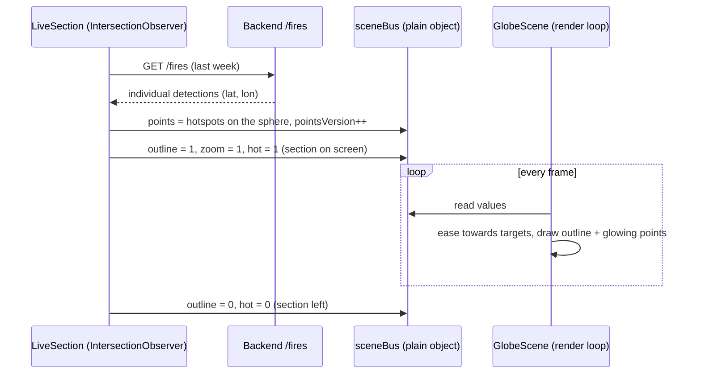

### 3.2 Team — `/equipo`

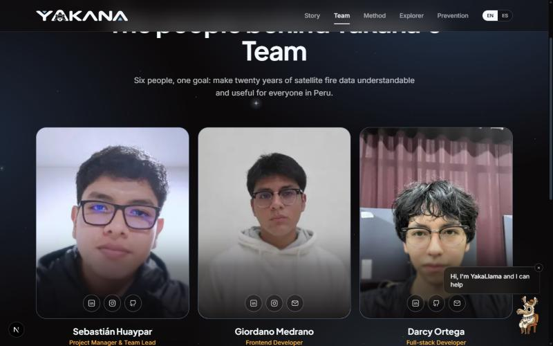

Photo cards: the whole card is the person's photo with a soft dark blur at the bottom. **Hovering (or tapping, or pressing Enter) flips the card** to show that person's contribution. The social icons (LinkedIn, Instagram, GitHub, email) sit in a layer that does **not** rotate, so they stay clickable on both faces. The name and role go under the card.

Everything comes from one list, [`team.ts`](src/app/equipo/team.ts): to add or edit a person, change that file and drop the photo in `public/equipo/`. Only the links that exist are drawn. Cards respect `prefers-reduced-motion` (no flip animation, the face still changes on tap).

### 3.3 Method — `/metodo`

The harmonization made **auditable**. The route is a server `page.tsx` (metadata) rendering the client [`View.tsx`](src/app/metodo/View.tsx).

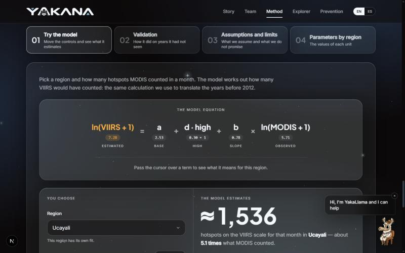

| Block | Component | What it shows |
| --- | --- | --- |
| Hero + key figures | `View` | "×8.9 → ×1.3": the apparent jump of 2011→2012 before/after harmonizing |
| 01 How it is built | [`ChapterCards`](src/app/metodo/ChapterCards.tsx) + [`ChapterContent`](src/app/metodo/ChapterContent.tsx) | Four expandable chapters: Data, Overlap, Model, Range |
| 02 The result | [`HarmonizeChart`](src/app/metodo/HarmonizeChart.tsx) | Morph between "as they arrive" and "corrected" with a slider |
| 03 Validation | `View` + [`DotRing`](src/app/metodo/DotRing.tsx) | R², error, coverage on years the model never saw |
| 04 Try it yourself | [`TechPanel`](src/app/metodo/TechPanel.tsx), [`Formula`](src/app/metodo/Formula.tsx), [`PeruFitMap`](src/app/metodo/PeruFitMap.tsx) | **Four tabs across the top** — Try the model (the equation by terms with its value, and a calculator), Validation by zone, Assumptions and limits, Parameters by region (+ CSV) |

Data comes from [`useMethodData()`](src/lib/method-data.ts): a real **snapshot first, live data second** (see [§5](#5-data-layer)). The "as they arrive" line uses the raw MODIS + VIIRS counts from the backend team's extraction, because the API only serves harmonized values.

### 3.4 Explorer — `/explorador`

Pick **region + year + month** and everything updates.

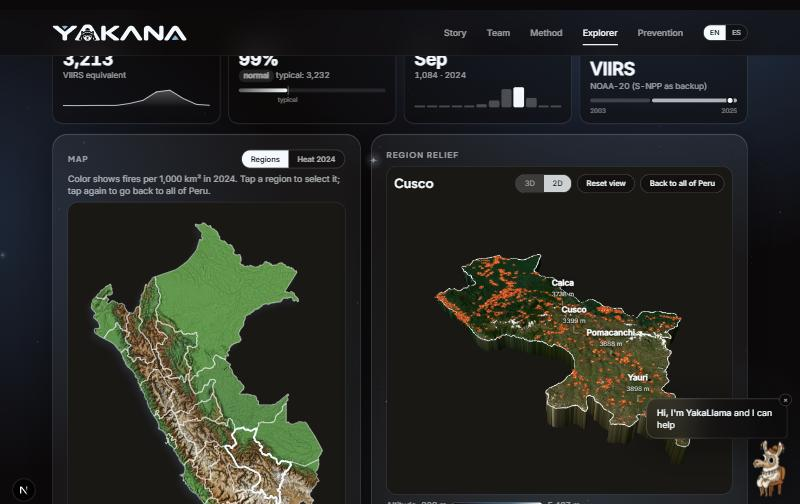

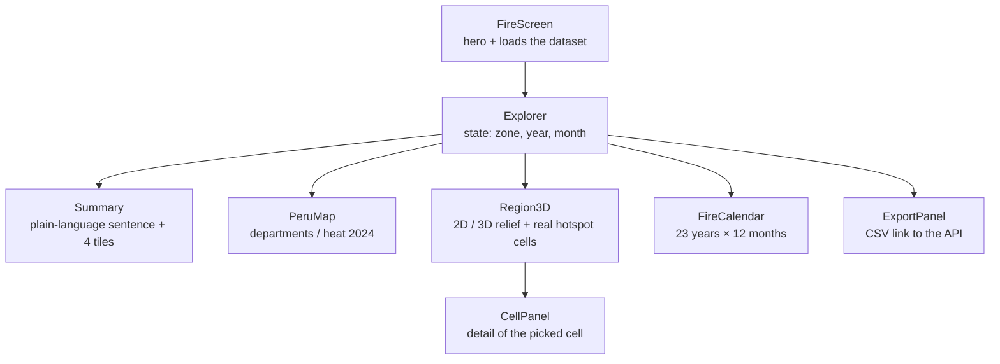

- **Dataset** ([`lib/fire-data.ts`](src/app/explorador/lib/fire-data.ts)): `/regions` + one `/calendar` per region (monthly harmonized series 2003–2025 with p10–p90 range and an *estimated* flag) + `/heatmap` for the heat layer.
- **Relief**: each department's relief and imagery are **pre-generated** (`public/explorador/regions/`) and cached forever; the 2D/3D toggle switches between a flat and a 3D view of the same real hotspot cells. Department outlines come from geoBoundaries.
- **Calendar**: one cell per month, value inside the cell, dotted border for months estimated from MODIS. Two colour modes: *how many* and *unusual?* (percentile against the same month in 2003–2022).
- **Statuses** (high / low / normal) are computed from the baseline years 2003–2022, the same baseline the API uses.
- Loading and error states with a retry button; nothing renders from invented data.

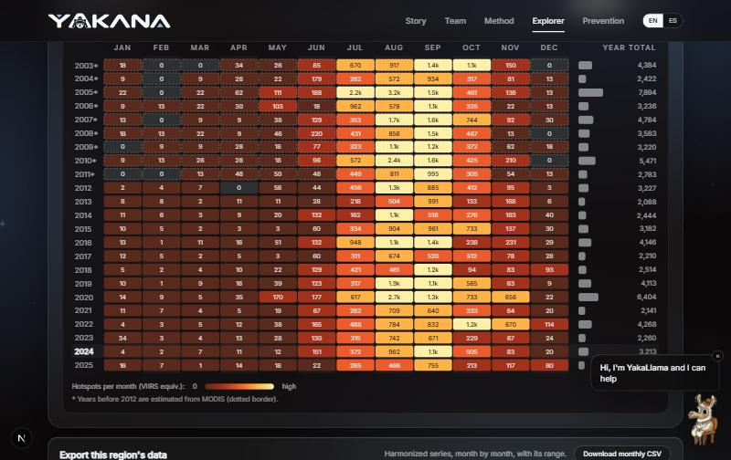

### 3.5 Prevention — `/prevencion`

Built for people who have to **act**, and written in plain, friendly language, mobile-first. It starts from a single question and answers it with real data.

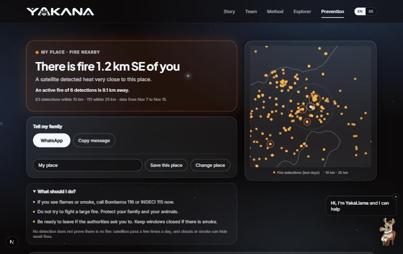

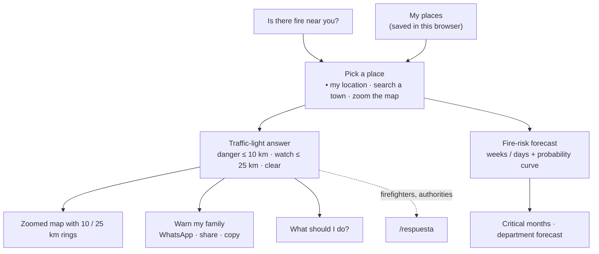

| Block | What it does | Endpoints |
| --- | --- | --- |
| **Picker** | Use my location, search a town (OpenStreetMap), or use the **map**: scroll to zoom (it zooms where the cursor is), drag to move, click your house. On a phone, a tap zooms in and the next tap picks. The border check uses the real department outlines. Saved places are listed first. | `/fires`, `/events` |
| **Answer** | Traffic light from the nearest detection (≤ 10 km danger, ≤ 25 km watch), counts within each ring, an active fire nearby if there is one, and a zoomed [`FireMap`](src/app/prevencion/FireMap.tsx). | `/fires`, `/events` |
| **Warn my family** | A plain-text message with the real facts, through WhatsApp (`wa.me`), the system share sheet or the clipboard. **No message is sent from our servers.** | – |
| **Forecast** | [`RiskForecast`](src/app/prevencion/RiskForecast.tsx): a headline, a strip with a flame and a probability per period, and a smooth probability curve with *medium* and *high* bands. **Weeks** (next 8) or **Days** (next 14). | `/prevention/model`, `/prevention/model/info`, `/recurrence/place` |
| **Season** | Critical months of that place and the department's monthly forecast with its measured accuracy. | `/recurrence/place`, `/forecast` |
| **My places** | Up to 8 places saved in the browser, each with its current level. | `/fires` |

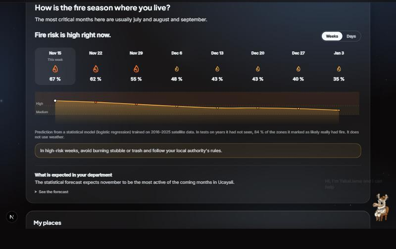

**How the forecast is computed in the browser**

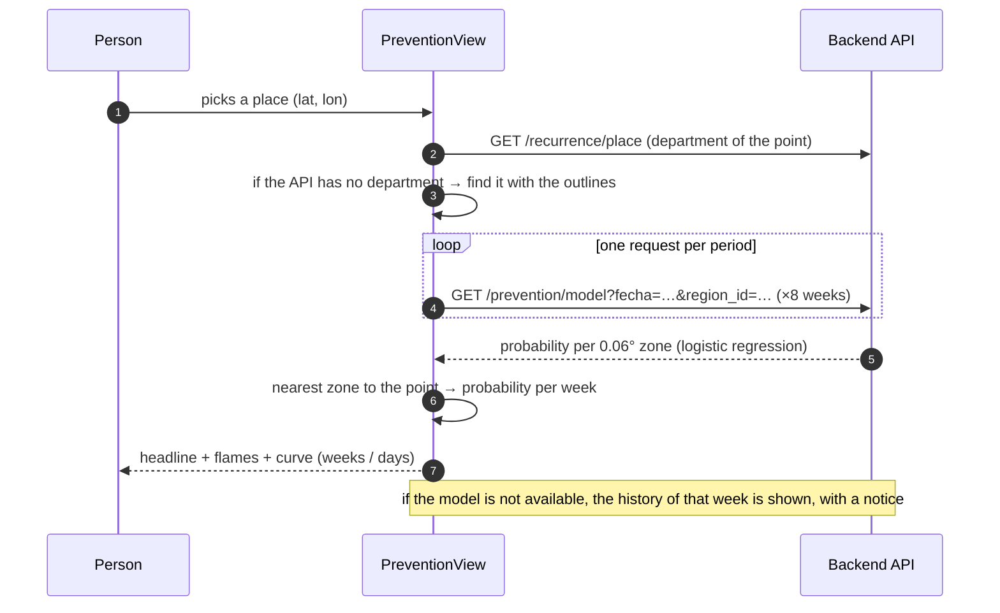

- The probability comes from the team's **logistic regression** ([root README §6](../README.md#6-the-prevention-model)). The page says so, shows how the model did on years it had not seen, and says plainly that it **uses no weather**.
- Levels: **high** ≥ 50 %, **medium** ≥ 20 %. A probability below 5 % is shown as "< 5 %". The curve's scale adapts to the data, and the *high* band is drawn only when it fits.
- **Privacy**: saved places never leave the browser (`localStorage`, `yakana-places`). Coordinates are sent to the team's API only to read the zone, and a search text is sent to OpenStreetMap. The page says so.
- **Limits**: *no detection does not prove there is no fire* (satellites pass a few times a day; clouds and smoke hide small fires). The page repeats this and shows the national emergency numbers (Bomberos 116 · INDECI 115).

Shared pieces: [`lib/geo-utils.ts`](src/lib/geo-utils.ts) (haversine distance, bearing, compass), [`lib/saved-places.ts`](src/lib/saved-places.ts) (the `localStorage` store), and the plain-language texts in [`prevencion/copy.ts`](src/app/prevencion/copy.ts).

> **Not built on purpose:** automatic alerts to a phone. They need a server that watches the API and writes to people; a fake "notify me" button would mislead users. That service is a task for the backend team (for example, a Telegram bot).

### 3.6 Response — `/respuesta`

For **firefighters, civil defense and local authorities**. It reuses [`FieldSection`](src/app/prevencion/FieldSection.tsx).

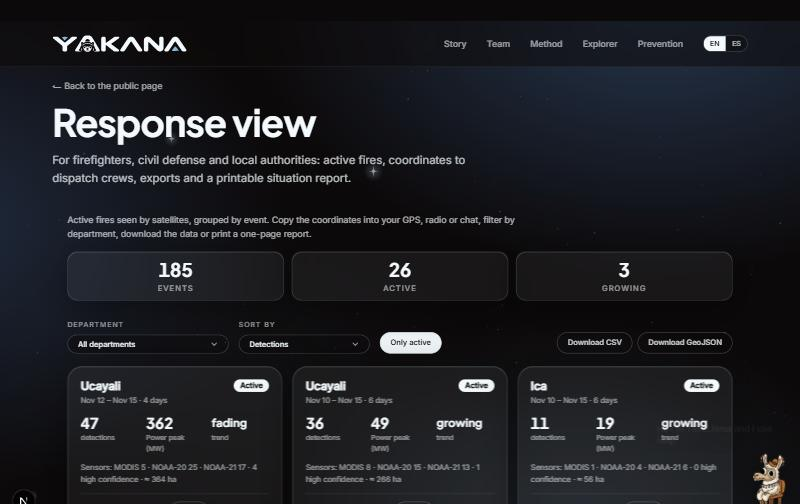

- Events come from `/events` (detections ≤ 1.2 km and ≤ 1 day apart chained together). Each card shows size, peak fire power (MW), trend, sensor split, high-confidence count, pixel area, and **coordinates with a copy button and a map link**.
- Department, sort and *only active* filters. The filtered list downloads as **CSV** or **GeoJSON** (generated in the browser).
- The **situation report** (`data-print-area`) summarizes scope, satellite window, totals, departments above their usual level and the five largest events. *Print / save as PDF* uses a print stylesheet that hides everything else (see `globals.css`); *Copy as text* produces the same report as plain text for radio or chat.

### 3.7 YakaLlama

A floating assistant ([`YakaLlama.tsx`](src/components/YakaLlama.tsx)) mounted in `layout.tsx`. It answers questions about fire in Peru, the method, how to use the site, and who built it. The **suggested questions change with the page** you are on.

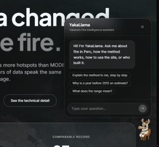

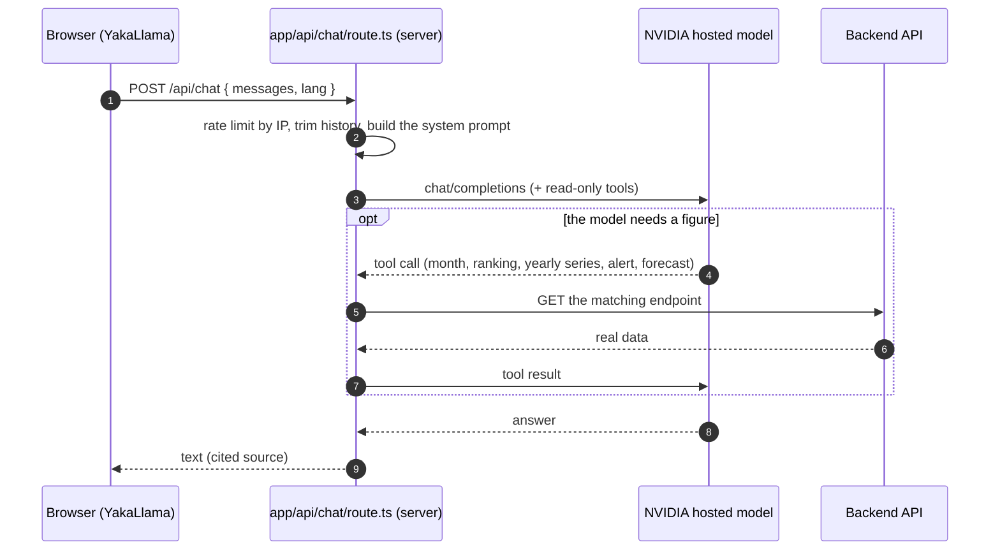

- The **system prompt** carries what the site is, the method (told as a short story), the pages, the team and the rules: answer only from the site and the backend, cite the source, never invent figures, refuse unrelated topics, and send emergencies to Bomberos (116).
- The model can call **five read-only tools** (a region-month, a ranking of regions, a yearly series, the last days' alert and the forecast). The figures come precomputed from the backend; the model only reads them.
- The key is read from `NVIDIA_API_KEY` **on the server**. The browser never sees it. The route limits each IP to 20 messages per minute and cuts a request after 60 s (the page cuts at 55 s and shows an error instead of waiting forever).
- The first question after a quiet period can be slow: the server function and the model both wake up.

---

## 4. Architecture

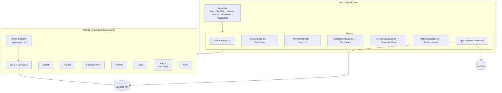

Principles:

- **Static first.** Every page is prerendered (`○ Static` in the build output). Live data is fetched in the browser; the only server code is the assistant's route.
- **Server `page.tsx` + client view.** Pages that need hooks keep a tiny server file for `metadata` and render a `"use client"` view.
- **No synthetic data.** If something cannot come from the API, it comes from a documented real source, or it is not shown.
- **One place per concern.** API access in `lib/api.ts`, language in `lib/lang.ts`, cards in `components/Card.tsx`, selectors in `components/Select.tsx`.
- **Footer.** A single-line [`SiteFooter`](src/components/SiteFooter.tsx) in the layout links to the repository.

---

## 5. Data layer

### 5.1 The client — [`lib/api.ts`](src/lib/api.ts)

- `API_URL` from `NEXT_PUBLIC_API_URL` (default: current Cloud Run deployment).
- `apiGet<T>(path, params, signal)` — GET with a 30 s timeout; API errors (`{"detail": "…"}`) become `ApiError`.
- `apiUrl(path, params)` — a plain URL for download links (CSV needs no `fetch`).
- **Typed responses** (`ApiCalendar`, `ApiAlert`, `ApiPlaceRecurrence`, `ApiEvents`, `ApiFires`, `ApiModelMap`, `ApiModelInfo`, …) because the API's OpenAPI document does not describe its responses.

### 5.2 The hook — [`lib/use-api.ts`](src/lib/use-api.ts)

```ts
const { data, error, loading, reload } = useApi<ApiAlert>("/alert");
const h = useApi<ApiPlaceRecurrence>("/recurrence/place", { lat: -9.5, lon: -74.9 });
```

It cancels the previous request when the path or params change and keeps the result keyed to its request, so the UI never shows stale data for a new selection.

### 5.3 Snapshot-then-live — [`lib/method-data.ts`](src/lib/method-data.ts)

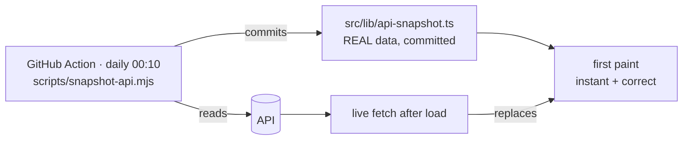

The snapshot holds the national yearly/monthly series, the typical year per zone, the per-department calibration and the validation. **It refreshes itself every day** (see [§14](#14-deployment-and-automation)); to refresh it by hand:

```bash
node scripts/snapshot-api.mjs                 # default API
API=https://my-api.example node scripts/snapshot-api.mjs
```

### 5.4 Which endpoint feeds what

| Endpoint | Used by |
| --- | --- |
| `/regions` | Explorer selectors |
| `/calendar?region_id=` | Explorer (every region), Method, snapshot, assistant |
| `/heatmap?start&end&region_id` | Explorer heat layer (year) and 3D hotspots (period + region) |
| `/export/mensual.csv?region_id=` | Explorer download button |
| `/fires` | Story (live globe, lens), Prevention (nearest fire) |
| `/events`, `/alert`, `/health` | Prevention (active fire nearby), Response, assistant |
| `/recurrence/place` | Prevention (critical months, department of a place) |
| `/forecast` | Prevention (monthly forecast), assistant |
| `/prevention/model`, `/prevention/model/info` | Prevention (probability per week or day, validation) |
| `/calibration`, `/validation` | Method |

> `/fires` only covers the **recent window** the backend downloaded (about one week). Historical locations use `/heatmap`, which accepts any date range.

---

## 6. Internationalization

English is the default; Spanish is one click away. The choice is remembered in `localStorage`.

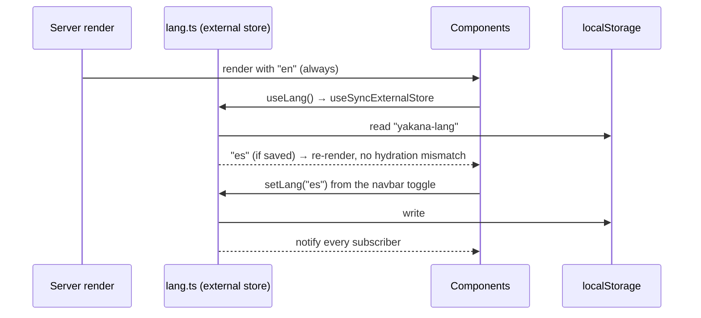

[`lib/lang.ts`](src/lib/lang.ts) exposes `useLang()`, `setLang()` and `<html lang>` is updated automatically. Each component keeps its strings next to the code in a `{ en, es }` dictionary:

```tsx
const TXT = {
  en: { title: "Peru burns every year" },
  es: { title: "El Perú arde cada año" },
};

function Hero() {
  const [lang] = useLang();
  const L = TXT[lang];
  return <h2>{L.title}</h2>;
}
```

Numbers and dates follow the language too (`toLocaleString(lang)`: `0.94` vs `0,94`). Place names are proper nouns and stay in Spanish; *Lima Metropolitana* is translated. The assistant answers in the language of the site.

---

## 7. Design system

### 7.1 Identity

The project is called **Yakana’s Fire Intelligence**; the team is **Yakana's Team**. The official logotype and isotype live in [`public/brand/`](public/brand/): the navbar and the Story title use the logotype (the isotype, a llama inside an "A", on narrow screens and as the favicon).

| Token | Value | Use |
| --- | --- | --- |
| `snow` | `#F3F9FC` | Text and highlights on the dark background |
| `slate` | `#4C6679` | Secondary elements, scrollbars |
| `navy` | `#283A54` | Depth, nebula, icon background |
| `ink` | `#0C090A` | Page background |
| `ember` | `#FF7A2F` | **Accent, only for fire and urgency**: hot points, active fires, high risk |
| `amber` | `#FFB347` | **Accent, only for emphasis**: results, highlights, medium risk |

`ember` and `amber` are Tailwind tokens (`bg-ember`, `text-amber`, …) defined in [`globals.css`](src/app/globals.css). Use them sparingly. Fonts: **Plus Jakarta Sans** (titles, `font-heading`) and **Inter** (body).

The page is dark by design: a fixed star canvas ([`StarField`](src/components/StarField.tsx)) and a navy nebula live in `layout.tsx`, so every page gets them automatically. Sections must be transparent with light text. Scrollbars are thin, slate and rounded, site-wide.

### 7.2 Shared building blocks

| Component | Purpose |
| --- | --- |
| [`Card`](src/components/Card.tsx) | **The only card.** Frosted glass (`.glass` / `.glass-dark`), 24 px radius, inner highlight |
| [`Select`](src/components/Select.tsx) | Custom accessible listbox (combobox role, full keyboard, opens upward when needed, rendered in a portal) |
| [`SectionDivider`](src/components/SectionDivider.tsx) | Numbered section divider `01 · LABEL ────` |
| [`Reveal`](src/components/Reveal.tsx) | Fade/slide-in when scrolled into view |
| [`Navbar`](src/components/Navbar.tsx), [`Logo`](src/components/Logo.tsx) | Fixed bar: official logo, five links, EN/ES toggle |
| [`SiteFooter`](src/components/SiteFooter.tsx) | One line with the link to the repository |
| [`SocialIcons`](src/components/SocialIcons.tsx) | LinkedIn, Instagram, GitHub and mail icons (SVG, no emojis anywhere) |
| [`YakaLlama`](src/components/YakaLlama.tsx) | The assistant |

```tsx
<Card as="article" className="p-5">…</Card>           // light glass
<Card tone="dark" className="rounded-[2rem] p-6">…</Card> // darker glass for text over bright imagery
```

### 7.3 Rhythm

Every section uses the same vertical rhythm so pages feel like one product:

```
section:  px-4 pb-16 pt-24  sm:px-6 sm:pb-24 sm:pt-32
divider:  mb-10 sm:mb-14
content:  max-w-6xl
```

### 7.4 Glass, in CSS

`.glass` (in [`globals.css`](src/app/globals.css)) uses raw `rgb()` values on purpose, so it looks identical inside the Method page, which remaps the palette tokens locally. Each glass card gets its own compositing layer (`transform: translateZ(0)`) to avoid backdrop-blur seams over the fixed background, and nested `backdrop-filter`s inside cards are avoided.

---

## 8. The 3D region view

When a department is chosen in the Explorer, [`Region3D`](src/components/explorador/Region3D.tsx) shows a relief model with **real terrain, real imagery and real hotspot cells**, in 2D or 3D.

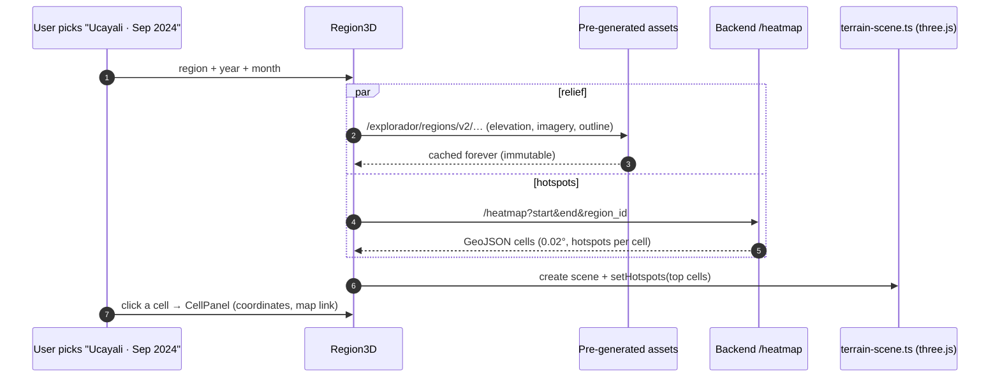

- **Real hotspots.** `/heatmap` returns the 0.02° (~2 km) cells with detections for the period. The cells with the most hotspots are drawn, sized by √hotspots; the page tells you how many exist in total.
- **Pre-generated relief.** The elevation and imagery of every department were generated once from open data (AWS Terrain Tiles + Sentinel-2 cloudless) and are served as static files with a versioned path, so a regeneration never reuses an old copy.
- **Prefetch.** Hovering a department for 300 ms starts downloading its assets and the 3D code; an idle timer pre-warms the WebGL renderer.
- **Region switching** disposes meshes and textures but **reuses the WebGL renderer**, avoiding context churn.
- Imagery credit (Sentinel-2 cloudless © EOX, CC BY-NC-SA) is always shown on screen.

---

## 9. Performance

| Technique | Where |
| --- | --- |
| Everything prerendered statically | all pages |
| Snapshot-first rendering (no spinner) | Story, Method |
| Parallel API calls (27 calendars in ~2.5 s; 8 model periods at once) | Explorer dataset, Prevention forecast |
| One retry per forecast request | Prevention |
| Dynamic `import()` of three.js code | only when a region is chosen |
| Versioned, immutable relief assets | 3D view |
| Canvas shaders read a plain object, not React state | globe, `sceneBus` |
| `overflow-x: clip` on `body` and single-layer glass cards | no horizontal scroll, smooth scroll |
| Hand-written SVG instead of a chart library | small bundle, forecast curve included |

---

## 10. Responsive and accessibility

- **Breakpoints** use Tailwind defaults. Pages are checked at **375 px** with no horizontal overflow; below 520 px the logo becomes the isotype so the five links and the language toggle fit.
- **Tabs and strips:** the Method tabs and the forecast strip scroll *inside* their card on narrow screens, never the page. Wide visuals (the calendar, tables) do the same.
- **Keyboard:** the custom `Select` supports arrows, Home/End, Enter/Space, Esc and type-ahead; the calendar supports arrow keys; tab lists follow the ARIA pattern; team cards flip with Enter/Space.
- **Semantics and labels:** charts are `role="img"` with descriptive `aria-label`s; decorative SVGs are `aria-hidden`; state is never conveyed by colour alone (pills and flames carry text and numbers).
- **Reduced motion:** animations respect `prefers-reduced-motion`.
- **Language:** `<html lang>` follows the selected language.

---

## 11. Project structure

```
frontend/
├─ public/
│  ├─ brand/              official logotype and isotype (SVG)
│  ├─ equipo/             team photos
│  ├─ images/             earth textures (NASA), llama, NASA logo
│  ├─ explorador/         hero relief image + pre-generated regions (v2)
│  └─ metodo/             Method page images
├─ scripts/
│  └─ snapshot-api.mjs    regenerates src/lib/api-snapshot.ts
├─ src/
│  ├─ app/
│  │  ├─ layout.tsx          fonts, StarField, nebula, Navbar, SiteFooter, YakaLlama
│  │  ├─ globals.css         palette tokens (incl. ember/amber), .glass, scrollbars, .nebula
│  │  ├─ icon.svg / icon.png / apple-icon.png    favicon (the official isotype)
│  │  ├─ historia/           Story page
│  │  ├─ equipo/             Team page (TeamView.tsx + team.ts)
│  │  ├─ metodo/             Method page (View.tsx + charts + TechPanel + Formula)
│  │  ├─ explorador/         Explorer: page + lib/ (data, geo, terrain, i18n, stats)
│  │  ├─ prevencion/         Prevention: PreventionView, RiskForecast, FireMap, FieldSection, copy.ts
│  │  ├─ respuesta/          Response page (ResponseView.tsx)
│  │  └─ api/chat/           the assistant's server route
│  ├─ components/
│  │  ├─ Card · Select · Reveal · SectionDivider · Navbar · Logo · SiteFooter · SocialIcons · StarField · YakaLlama
│  │  ├─ hero/               globe, live section, region card, scroll orchestration
│  │  ├─ sections/           Regions, Satellites, PixelLens
│  │  └─ explorador/         Explorer, Summary, PeruMap, Region3D, CellPanel, FireCalendar, …
│  └─ lib/
│     ├─ api.ts · use-api.ts       typed client + hook
│     ├─ lang.ts                   global EN/ES store
│     ├─ method-data.ts            snapshot-then-live data for Method
│     ├─ api-snapshot.ts           GENERATED real data (do not edit by hand)
│     ├─ fire-data.ts              typical-year data for Story
│     ├─ sensor-series.ts          raw monthly MODIS/VIIRS counts + ratio
│     ├─ geo-utils.ts              distance, bearing, compass
│     ├─ saved-places.ts           localStorage store for "my places"
│     ├─ scene-bus.ts              section ↔ globe channel
│     └─ peru-borders.ts           department outlines for the globe
├─ next.config.ts          redirects (/ and old names) and cache headers
├─ eslint.config.mjs
└─ AGENTS.md               notes for AI coding agents (Next.js 16)
```

The Explorer also ships Python helpers in `src/app/explorador/tools/` that were used to generate the static relief and the place-name list from open data.

---

## 12. Recipes: how to extend it

<details>
<summary><b>Add a new page</b></summary>

1. Create `src/app/<route>/page.tsx` (server, exports `metadata`) and a `View.tsx` marked `"use client"`.
2. Use the shared section rhythm and `SectionDivider` / `Card` / `Reveal`.
3. Add it to `links` in [`Navbar.tsx`](src/components/Navbar.tsx) with `{ en, es }` labels.
4. Keep all text in a `{ en, es }` dictionary. Use the project name **Yakana’s Fire Intelligence** in the page title.
</details>

<details>
<summary><b>Call a new API endpoint</b></summary>

1. Add the response type to [`lib/api.ts`](src/lib/api.ts).
2. In a client component: `const { data, error, loading, reload } = useApi<MyType>("/path", { param })`.
3. Render a loading state and an error state with a retry button.
</details>

<details>
<summary><b>Add or edit a team member</b></summary>

Edit [`src/app/equipo/team.ts`](src/app/equipo/team.ts) (name, role and contribution in EN/ES, links) and put the photo in `public/equipo/`. Only the links you fill in are drawn.
</details>

<details>
<summary><b>Teach the assistant something new</b></summary>

Add it to the "Información de la página" block of the system prompt in [`app/api/chat/route.ts`](src/app/api/chat/route.ts). For a figure that must come from the backend, add a read-only tool there instead, and add suggested questions in [`YakaLlama.tsx`](src/components/YakaLlama.tsx) (they are keyed by page).
</details>

<details>
<summary><b>Add a string or a language</b></summary>

Strings live beside the code. To add a third language, extend the `Lang` type in [`lib/lang.ts`](src/lib/lang.ts), add the key to every `{ en, es }` dictionary (TypeScript will list the missing ones) and add the button in the navbar.
</details>

<details>
<summary><b>Update the real-data snapshot</b></summary>

It updates itself every day. By hand:

```bash
node scripts/snapshot-api.mjs && npx prettier --write src/lib/api-snapshot.ts
```
</details>

<details>
<summary><b>Point to another backend</b></summary>

Set `NEXT_PUBLIC_API_URL` (locally in `.env.local`, in production in the Vercel project settings) and, if the data changed, regenerate the snapshot with `API=…`.
</details>

---

## 13. Conventions and workflow

- **Branches/merges:** feature branches are merged with real merge commits (`--no-ff`) so each teammate keeps authorship. Keep the last commit on `main` signed by a Vercel team member (see [§14](#14-deployment-and-automation)).
- **Commits:** descriptive messages that explain *what* and *why* (the repo is reviewed by the jury).
- **Before pushing:** `npx tsc --noEmit && npm run lint && npm run build`.
- **Formatting:** Prettier. Some files written by teammates use CRLF line endings; keep each file's style when editing.
- **No synthetic data.** Do not add mock arrays. If the API cannot provide something, document the real source or leave it out.
- **No emojis in the UI.** Use SVG icons.
- **Styling:** reuse `Card`, the brand colours and the section rhythm; do not invent new card styles. `ember` and `amber` only for fire and emphasis.
- **Backend** lives in `../backend` and belongs to the backend team: do not edit it from frontend work.

---

## 14. Deployment and automation

**Vercel**

| Setting | Value |
| --- | --- |
| Framework | Next.js |
| **Root Directory** | `frontend` |
| Build command | `npm run build` (default) |
| Domain | `yakanas.earth` (and `www`) |
| Environment variables | `NEXT_PUBLIC_API_URL` (optional) · `NVIDIA_API_KEY` (server only) · `NVIDIA_MODEL` (optional) |

The pages are static; the only server runtime is the assistant's route (`maxDuration = 60`). CORS on the API is open, so the browser calls it directly. After changing an environment variable, **redeploy**: variables are only applied to new deployments.

**Daily data refresh** — [`.github/workflows/daily-data.yml`](../.github/workflows/daily-data.yml)

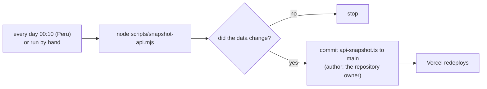

If the API is down the job fails and nothing is committed, so the snapshot is never corrupted. The commit uses the repository owner's identity because Vercel's Hobby plan blocks deployments whose last commit is authored by someone outside the team (the "Deployment was blocked" status).

---

## 15. Troubleshooting

| Symptom | Cause / fix |
| --- | --- |
| Explorer, Prevention or Response show "could not reach the data" | The API is down or the URL is wrong: check `NEXT_PUBLIC_API_URL` and `GET /health`. The retry button reloads. |
| The forecast says "the prediction is not available" | `/prevention/model` did not answer; the page falls back to the history of each week. Check the API (`GET /prevention/model/info`). |
| The assistant says "not set up yet" | `NVIDIA_API_KEY` is missing. Set it in `.env.local` or in Vercel and redeploy. |
| The assistant stays on "is writing…" the first time | A cold start. Ask again; after about a minute it gives an error instead of waiting. |
| Method/Story numbers look stale | The daily Action refreshes them; or run `node scripts/snapshot-api.mjs`. Live data replaces the snapshot after load anyway. |
| Vercel shows "Deployment was blocked" | The last commit on `main` was authored by someone who is not in the Vercel team. Push a commit authored by a team member. |
| 3D region is slow the first time | Assets are loading; the second visit is cached. Hover a department to pre-load it. |
| 3D has no hotspots | The API returned no cells for that region and period ("No hotspots detected in this period"). |
| CSS or theme change not applied in dev | Restart the dev server and delete `.next/`. |
| `tsc` says `LayoutProps` not found | Run `npm run dev` or `npm run build` once; Next generates those types. |
| Port 3000 busy on Windows | Stop the old process, then `npm run dev -- -p 3000`. |

---

<sub>Data © NASA FIRMS · Terrain: AWS Open Data · Imagery: Sentinel-2 cloudless © EOX (CC BY-NC-SA) · Boundaries: geoBoundaries · Places: GeoNames (CC BY 4.0). See the [root README](../README.md#10-data-sources-licenses-and-credits).</sub>
