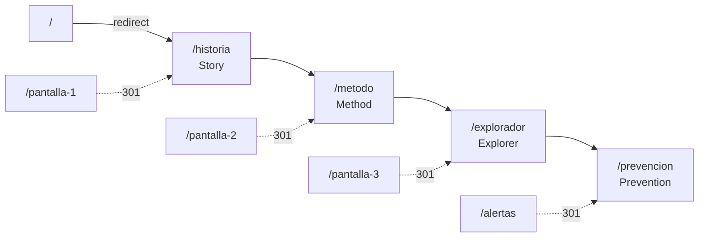
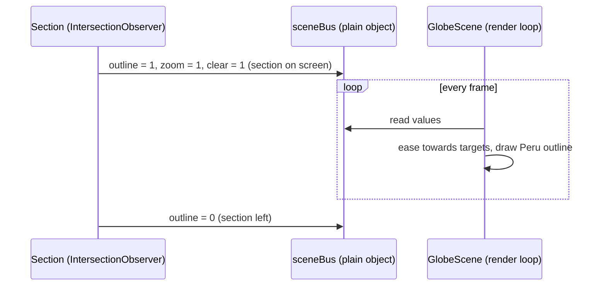
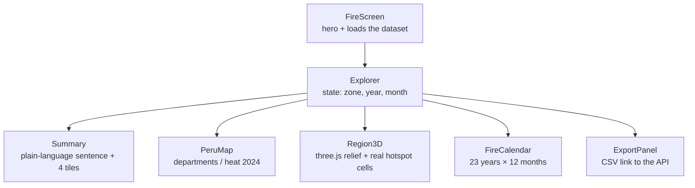
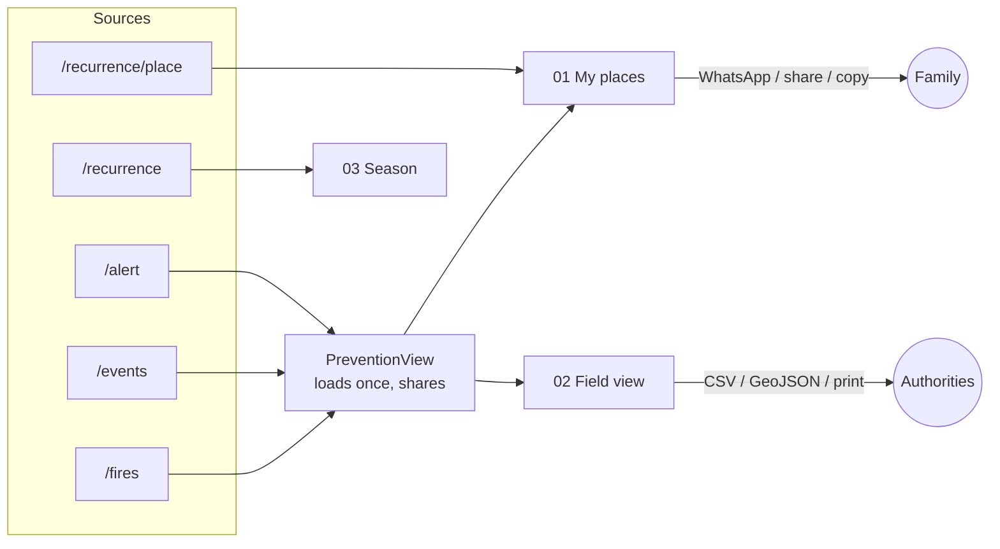
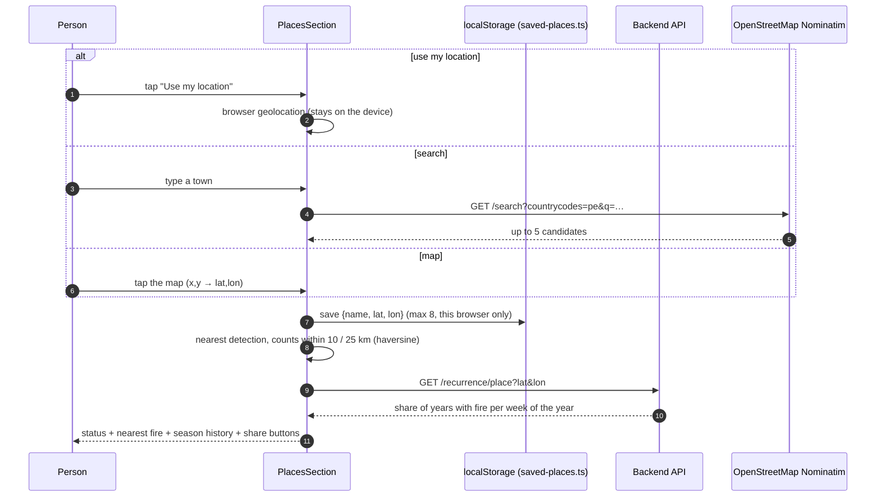
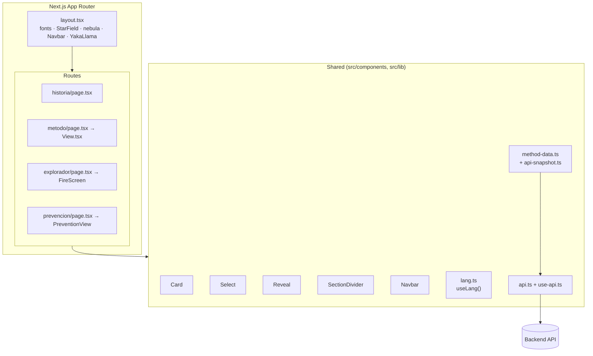
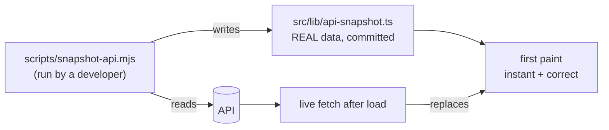
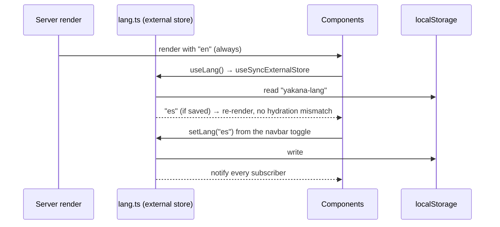
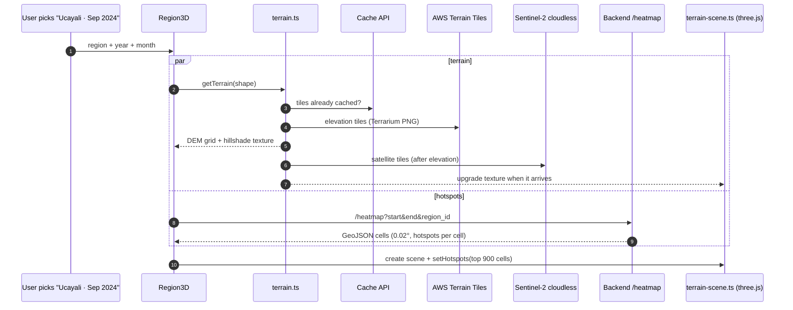

# Frontend · Yakana's Team

The website of the **Fire Calendar of Peru**: four bilingual (EN/ES) pages that explain, explore and help people act on Peru's satellite fire hotspots, harmonized across NASA's MODIS and VIIRS sensors.

> Project overview, the science and the full architecture are in the [root README](../README.md). This document is about **how the frontend is built and how to work on it**.


---

## Contents

1. [Quick start](#1-quick-start)
2. [Tech stack](#2-tech-stack)
3. [Pages](#3-pages)
4. [Architecture](#4-architecture)
5. [Data layer](#5-data-layer)
6. [Internationalization](#6-internationalization)
7. [Design system](#7-design-system)
8. [The 3D region view](#8-the-3d-region-view)
9. [Performance](#9-performance)
10. [Responsive and accessibility](#10-responsive-and-accessibility)
11. [Project structure](#11-project-structure)
12. [Recipes: how to extend it](#12-recipes-how-to-extend-it)
13. [Conventions and workflow](#13-conventions-and-workflow)
14. [Deployment](#14-deployment)
15. [Troubleshooting](#15-troubleshooting)

---

## 1. Quick start

Requirements: **Node.js 20.9+** and npm. No backend needed — the site calls the deployed API.

```bash
cd frontend
npm install
npm run dev          # http://localhost:3000  → redirects to /historia
```

| Command | What it does |
| --- | --- |
| `npm run dev` | Dev server (Turbopack) on :3000 |
| `npm run build` | Production build (everything is prerendered statically) |
| `npm start` | Serve the production build |
| `npm run lint` | ESLint (includes the React Hooks rules) |
| `npx tsc --noEmit` | Type-check |
| `node scripts/snapshot-api.mjs` | Regenerate [`src/lib/api-snapshot.ts`](src/lib/api-snapshot.ts) from the live API |

**Environment** — one optional variable:

```bash
cp .env.example .env.local
# NEXT_PUBLIC_API_URL=https://calendario-fuego-1022991169828.southamerica-west1.run.app
```

Without it the site uses the current deployment. When the API moves to its final address, **this is the only line that changes**.

> ⚠️ This project uses a very recent Next.js (16). Read [`AGENTS.md`](AGENTS.md) and the docs inside `node_modules/next/dist/docs/` before relying on older conventions.

---

## 2. Tech stack

| Area | Choice | Why |
| --- | --- | --- |
| Framework | **Next.js 16** (App Router, Turbopack, `cacheComponents`) | Static prerender + client islands, great DX |
| UI | **React 19.3**, **TypeScript** | Types for every API response |
| Styling | **Tailwind CSS 4** (`@theme inline`, `@layer base`) | Design tokens as CSS variables, no CSS files per component |
| 3D | **three.js** + **@react-three/fiber** | Day/night globe, relief terrain with hotspots |
| Motion | **motion** (Framer Motion successor) | Reveal and chart animations in the Method page |
| Charts | Hand-written **SVG** | Full control, tiny bundle, accessible |
| Data | `fetch` + a small typed client | No heavy data library needed |

---

## 3. Pages



Old working names (`/pantalla-N`) permanently redirect, so shared links keep working (see [`next.config.ts`](next.config.ts)).

### 3.1 Story — `/historia`

A narrative landing page driven by scroll.

| Section | Component | Data |
| --- | --- | --- |
| Hero + globe | [`HeroScroll`](src/components/hero/HeroScroll.tsx), [`GlobeScene`](src/components/hero/GlobeScene.tsx) | NASA GIBS textures; custom GLSL shader blends day/night and the globe travels to Peru |
| 01 The phenomenon | [`FireClock`](src/components/hero/FireClock.tsx) | Typical year, mean of each month over 2012–2025 (snapshot) |
| 02 Three regions | [`Regions`](src/components/sections/Regions.tsx), [`RegionCard`](src/components/hero/RegionCard.tsx) | Typical year of Coast / Highlands / Rainforest |
| 03 The satellites | [`TwoEyes`](src/components/sections/TwoEyes.tsx) | **Live** `/fires`: real MODIS (1 km) vs VIIRS (375 m) detections |
| 04 The solution | [`Harmonization`](src/components/sections/Harmonization.tsx) | Raw monthly MODIS/VIIRS + harmonized series and range |

The globe is a fixed, sticky layer behind the page. Sections talk to it through a tiny shared object, [`sceneBus`](src/lib/scene-bus.ts) (`outline`, `zoom`, `clear`), instead of React state — the scene reads it every frame without re-rendering.



### 3.2 Method — `/metodo`

The harmonization made **auditable**. The route is a server `page.tsx` (metadata) rendering the client [`View.tsx`](src/app/metodo/View.tsx).

| Block | Component | What it shows |
| --- | --- | --- |
| Hero + key figures | `View` | "×8.9 → ×1.3": the apparent jump of 2011→2012 before/after harmonizing |
| 01 How it is built | [`ChapterCards`](src/app/metodo/ChapterCards.tsx) + [`ChapterContent`](src/app/metodo/ChapterContent.tsx) | Four expandable chapters: Data, Overlap, Model, Range |
| 02 The result | [`HarmonizeChart`](src/app/metodo/HarmonizeChart.tsx) | Morph between "as they arrive" and "corrected" with a slider |
| 03 Validation | `View` + [`DotRing`](src/app/metodo/DotRing.tsx) | R², error, coverage on years the model never saw |
| 04 Under the hood | [`TechPanel`](src/app/metodo/TechPanel.tsx) | Simulator of the formula, validation by zone, assumptions and limits, parameters table + CSV |

Data comes from [`useMethodData()`](src/lib/method-data.ts): a real **snapshot first, live data second** (see [§5](#5-data-layer)). The "as they arrive" line uses the raw MODIS + VIIRS counts from the backend team's extraction, because the API only serves harmonized values.

### 3.3 Explorer — `/explorador`

Pick **region + year + month** and everything updates.



- **Dataset** ([`lib/fire-data.ts`](src/app/explorador/lib/fire-data.ts)): `/regions` + one `/calendar` per region (monthly harmonized series 2003–2025 with p10–p90 range and an *estimated* flag) + `/heatmap` for the heat layer.
- **Calendar**: one cell per month, value inside the cell, dotted border for months estimated from MODIS. Two colour modes: *how many* and *unusual?* (percentile against the same month in 2003–2022).
- **Statuses** (high / low / normal) are computed from the baseline years 2003–2022, the same baseline the API uses.
- Loading and error states with a retry button; nothing renders from invented data.

### 3.4 Prevention — `/prevencion`

Built for people who have to **act**: families and farmers, firefighters and local authorities. Everything is live data and nothing is simulated.


| Section | Audience | What it does | Endpoints |
| --- | --- | --- | --- |
| **01 My places** | Families, farmers | Save places (use my location, search, or tap the map). Each place is compared with the last week of satellite detections and with the history of its ~6 km zone, then can be shared with family. | `/fires`, `/events`, `/alert`, `/recurrence/place` |
| **02 Field view** | Firefighters, authorities | Active fire events with copy-ready coordinates, department/sort/active filters, CSV and GeoJSON download, and a one-page printable **situation report**. | `/events`, `/alert` |
| **03 Season** | Planners, farmers | Map of zones where fire usually appears around a chosen date, ranked by department, with the measured reliability of that history. | `/recurrence` |



**My places in detail**



- **Status** is computed in the browser from `/fires`: detection within **10 km** → *Fire detected nearby*, within **25 km** → *in the area*, otherwise *no detections within 25 km*. An active event (`/events`) within 25 km is called out with its size.
- **Season history** uses the API's week-of-year frequency for the ~6 km zone around the point and highlights the current week.
- **Share**: a plain-text message with the real facts (status, nearest detection, history, coordinates, data window and a link) is sent through WhatsApp (`wa.me`), the system share sheet or the clipboard. **No message is sent from our servers** — there is no server.
- **Privacy**: saved places never leave the browser (`localStorage`). Coordinates are sent to the team's API only to read the history of the zone, and a search text is sent to OpenStreetMap. The page says so.
- **Limits**: *no detection does not prove there is no fire* (satellites pass a few times a day, clouds and smoke hide small fires). The page repeats this on every place and shows the national emergency numbers (Bomberos 116 · INDECI 115).

**Field view in detail**

- Events come from `/events` (detections ≤ 1.2 km and ≤ 1 day apart chained together). Each card shows size, peak fire power (MW), trend, sensor split, high-confidence count, pixel area, and **coordinates with a copy button and a map link**.
- The filtered list downloads as **CSV** or **GeoJSON** (generated in the browser).
- The **situation report** (`data-print-area`) summarizes scope, satellite window, totals, departments above their usual level and the five largest events. *Print / save as PDF* uses a print stylesheet that hides everything else (see `globals.css`); *Copy as text* produces the same report as plain text for radio or chat.

**Season in detail**

- `/recurrence?fecha&ventana&minimo` returns 0.06° zones (≈ 6.6 km) with the share of past years that had fire within ± *window* days of the date.
- The page also shows the API's own back-test (2019–2025): for example, zones with a 60–80 % history burned about 85 % of the time in the test years. It is history that repeats, **not** a weather forecast.
- Month, window (7/15/30 days) and minimum frequency are adjustable; the default month is the current one.

Shared pieces: [`FireMap`](src/app/prevencion/FireMap.tsx) draws the department outlines with any mix of detections, active events, zones and saved places; [`lib/geo-utils.ts`](src/lib/geo-utils.ts) has haversine distance, bearing and compass; [`lib/saved-places.ts`](src/lib/saved-places.ts) is the `localStorage` store.

> **Not built on purpose:** automatic alerts to a phone. They need a server that watches the API and writes to people; a fake "notify me" button would mislead users. That service is a task for the backend team (for example, a Telegram bot).

### 3.5 YakaLlama

A floating assistant ([`YakaLlama.tsx`](src/components/YakaLlama.tsx)) mounted in `layout.tsx`. The chat panel and greeting are ready; replies are disabled until the model is connected.

---

## 4. Architecture



Principles:

- **Static first.** Every route is prerendered (`○ Static` in the build output). Live data is fetched in the browser.
- **Server `page.tsx` + client view.** Pages that need hooks keep a tiny server file for `metadata` and render a `"use client"` view.
- **No synthetic data.** If something cannot come from the API, it comes from a documented real source, or it is not shown.
- **One place per concern.** API access in `lib/api.ts`, language in `lib/lang.ts`, cards in `components/Card.tsx`, selectors in `components/Select.tsx`.

---

## 5. Data layer

### 5.1 The client — [`lib/api.ts`](src/lib/api.ts)

- `API_URL` from `NEXT_PUBLIC_API_URL` (default: current Cloud Run deployment).
- `apiGet<T>(path, params, signal)` — GET with a 30 s timeout; API errors (`{"detail": "…"}`) become `ApiError`.
- `apiUrl(path, params)` — a plain URL for download links (CSV needs no `fetch`).
- **Typed responses** (`ApiCalendar`, `ApiAlert`, `ApiPlaceRecurrence`, `ApiEvents`, `ApiFires`, …) because the API's OpenAPI document does not describe its responses.

### 5.2 The hook — [`lib/use-api.ts`](src/lib/use-api.ts)

```ts
const { data, error, loading, reload } = useApi<ApiAlert>("/alert");
const h = useApi<ApiPlaceRecurrence>("/recurrence/place", { lat: -9.5, lon: -74.9 });
```

It cancels the previous request when the path or params change and keeps the result keyed to its request, so the UI never shows stale data for a new selection.

### 5.3 Snapshot-then-live — [`lib/method-data.ts`](src/lib/method-data.ts)



The snapshot holds the national yearly/monthly series, the typical year per zone, the per-department calibration and the validation. Refresh it whenever the backend publishes a new version:

```bash
node scripts/snapshot-api.mjs                 # default API
API=https://my-api.example node scripts/snapshot-api.mjs
```

### 5.4 Which endpoint feeds what

| Endpoint | Used by |
| --- | --- |
| `/regions` | Explorer selectors |
| `/calendar?region_id=` | Explorer (every region), Method, snapshot |
| `/heatmap?start&end&region_id` | Explorer heat layer (year) and 3D hotspots (period + region) |
| `/export/mensual.csv?region_id=` | Explorer and Prevention download buttons |
| `/fires`, `/events`, `/alert`, `/health` | Prevention: my places, field view |
| `/recurrence`, `/recurrence/place` | Prevention: season map, history of a place |
| `/calibration`, `/validation` | Method |
| `/fires` | Story lens and Prevention (last week, individual detections) |

> `/fires` and `/heat` only cover the **recent window** the backend downloaded (about one week). Historical locations use `/heatmap`, which accepts any date range.

---

## 6. Internationalization

English is the default; Spanish is one click away. The choice is remembered in `localStorage`.



[`lib/lang.ts`](src/lib/lang.ts) exposes `useLang()`, `setLang()` and `<html lang>` is updated automatically. Each component keeps its strings next to the code in a `{ en, es }` dictionary:

```tsx
const TXT = {
  en: { title: "Peru burns every year" },
  es: { title: "El Perú arde cada año" },
};

function Hero() {
  const [lang] = useLang();
  const L = TXT[lang];
  return <h2>{L.title}</h2>;
}
```

Numbers and dates follow the language too (`toLocaleString(lang)`: `0.94` vs `0,94`). Place names are proper nouns and stay in Spanish; *Lima Metropolitana* is translated.

---

## 7. Design system

### 7.1 Identity

| Token | Value | Use |
| --- | --- | --- |
| `snow` | `#F3F9FC` | Text and highlights on the dark background |
| `slate` | `#4C6679` | Secondary elements |
| `navy` | `#283A54` | Depth, nebula, icon background |
| `ink` | `#0C090A` | Page background |

Only these four colours are used (plus transparencies). Fonts: **Irish Grover** (logo, `font-logo`), **Plus Jakarta Sans** (titles, `font-heading`), **Inter** (body).

The page is dark by design: a fixed star canvas ([`StarField`](src/components/StarField.tsx)) and a navy nebula live in `layout.tsx`, so every page gets them automatically. Sections must be transparent with light text.

### 7.2 Shared building blocks

| Component | Purpose |
| --- | --- |
| [`Card`](src/components/Card.tsx) | **The only card.** Frosted glass (`.glass` / `.glass-dark`), 24 px radius, inner highlight |
| [`Select`](src/components/Select.tsx) | Custom accessible listbox (combobox role, full keyboard, opens upward when needed, rendered in a portal) |
| [`SectionDivider`](src/components/SectionDivider.tsx) | Numbered section divider `01 · LABEL ────` |
| [`Reveal`](src/components/Reveal.tsx) | Fade/slide-in when scrolled into view |
| [`Navbar`](src/components/Navbar.tsx) | Fixed bar: logo, 4 links, EN/ES toggle |
| [`YakaLlama`](src/components/YakaLlama.tsx) | Floating chatbot |

```tsx
<Card as="article" className="p-5">…</Card>           // light glass
<Card tone="dark" className="rounded-[2rem] p-6">…</Card> // darker glass for text over bright imagery
```

### 7.3 Rhythm

Every section uses the same vertical rhythm so pages feel like one product:

```
section:  px-4 pb-16 pt-24  sm:px-6 sm:pb-24 sm:pt-32
divider:  mb-10 sm:mb-14
content:  max-w-6xl
```

### 7.4 Glass, in CSS

`.glass` (in [`globals.css`](src/app/globals.css)) uses raw `rgb()` values on purpose, so it looks identical inside the Method page, which remaps the palette tokens locally. Each glass card gets its own compositing layer (`transform: translateZ(0)`) to avoid backdrop-blur seams over the fixed background, and nested `backdrop-filter`s inside cards are avoided.

---

## 8. The 3D region view

When a department is chosen in the Explorer, [`Region3D`](src/components/explorador/Region3D.tsx) builds a relief model with **real terrain, real imagery and real hotspot cells**.



- **Real hotspots.** `/heatmap` returns the 0.02° (~2 km) cells with detections for the period. The 900 cells with the most hotspots are drawn, sized by √hotspots; the page tells you how many exist in total (e.g. *Ucayali, Sep 2024: 2 445 cells*).
- **Real terrain.** AWS Terrain Tiles give the elevation; the texture is a hillshade first, replaced by Sentinel-2 imagery when it arrives.
- **Prefetch.** Hovering a department for 300 ms starts downloading its terrain and the 3D code; an idle timer pre-warms the WebGL renderer.
- **Cache.** Tiles are stored in the browser **Cache API** (`yakana-tiles-v1`), so returning to a region is nearly instant, even in later visits.
- **Smaller downloads.** Elevation is capped at ~760 px per side and imagery at ~1 400 px (about half the tiles of the first version) with no visible loss in 3D.
- **Region switching** disposes meshes and textures but **reuses the WebGL renderer**, avoiding context churn.
- Imagery credit (Sentinel-2 cloudless © EOX, CC BY-NC-SA) is always shown on screen.

---

## 9. Performance

| Technique | Where |
| --- | --- |
| Everything prerendered statically | all routes |
| Snapshot-first rendering (no spinner) | Story, Method |
| Parallel API calls (27 calendars in ~2.5 s) | Explorer dataset |
| Dynamic `import()` of three.js code | only when a region is chosen |
| Cache API + prefetch for map tiles | 3D view |
| Canvas shaders read a plain object, not React state | globe, `sceneBus` |
| `overflow-x: clip` on `body` and single-layer glass cards | no horizontal scroll, smooth scroll |
| Hand-written SVG instead of a chart library | small bundle |

---

## 10. Responsive and accessibility

- **Breakpoints** use Tailwind defaults. Pages are checked at **375 px** with no horizontal overflow; the navbar shortens the logo to "Yakana's" below 400 px so four links and the language toggle fit.
- **Grids:** alert cards are 2 columns on mobile, 3 on tablet, 4 on desktop. Wide visuals (the calendar, tables) scroll *inside* their card, never the page.
- **Keyboard:** the custom `Select` supports arrows, Home/End, Enter/Space, Esc and type-ahead; the calendar supports arrow keys; tab lists follow the ARIA pattern.
- **Semantics and labels:** charts are `role="img"` with descriptive `aria-label`s; decorative SVGs are `aria-hidden`; state is never conveyed by colour alone (pills carry text).
- **Reduced motion:** animations respect `prefers-reduced-motion`.
- **Language:** `<html lang>` follows the selected language.

---

## 11. Project structure

```
frontend/
├─ public/
│  ├─ images/            earth textures (NASA), llama, NASA logo
│  ├─ explorador/        hero relief image
│  └─ metodo/            Method page images
├─ scripts/
│  └─ snapshot-api.mjs   regenerates src/lib/api-snapshot.ts
├─ src/
│  ├─ app/
│  │  ├─ layout.tsx          fonts, StarField, nebula, Navbar, YakaLlama
│  │  ├─ globals.css         palette tokens, .glass, .bg-stars, .nebula
│  │  ├─ icon.svg / icon.png / apple-icon.png    favicon (the "Y" of the logo)
│  │  ├─ historia/           Story page
│  │  ├─ metodo/             Method page (View.tsx + charts + TechPanel)
│  │  ├─ explorador/         Explorer: page + lib/ (data, geo, terrain, i18n, stats)
│  │  └─ prevencion/         Prevention page: PreventionView, Places/Field/Season sections, FireMap
│  ├─ components/
│  │  ├─ Card · Select · Reveal · SectionDivider · Navbar · Logo · StarField · YakaLlama
│  │  ├─ hero/               globe, fire clock, region card, scroll orchestration
│  │  ├─ sections/           Regions, TwoEyes, Harmonization, Footer
│  │  └─ explorador/         Explorer, Summary, PeruMap, Region3D, FireCalendar, …
│  └─ lib/
│     ├─ api.ts · use-api.ts       typed client + hook
│     ├─ lang.ts                   global EN/ES store
│     ├─ method-data.ts            snapshot-then-live data for Method
│     ├─ api-snapshot.ts           GENERATED real data (do not edit by hand)
│     ├─ fire-data.ts              typical-year data for Story
│     ├─ sensor-series.ts          raw monthly MODIS/VIIRS counts + ratio
│     ├─ scene-bus.ts              section ↔ globe channel
│     └─ peru-borders.ts           department outlines for the globe
├─ next.config.ts          redirects (/ and old /pantalla-N names)
├─ eslint.config.mjs
└─ AGENTS.md               notes for AI coding agents (Next.js 16)
```

The Explorer also ships two Python helpers in `src/app/explorador/tools/` (`make_peru_relief.py`, `make_places.py`) that were used once to generate the static relief image and the place-name list from open data.

---

## 12. Recipes: how to extend it

<details>
<summary><b>Add a new page</b></summary>

1. Create `src/app/<route>/page.tsx` (server, exports `metadata`) and a `View.tsx` marked `"use client"`.
2. Use the shared section rhythm and `SectionDivider` / `Card` / `Reveal`.
3. Add it to `links` in [`Navbar.tsx`](src/components/Navbar.tsx) with `{ en, es }` labels.
4. Keep all text in a `{ en, es }` dictionary.
</details>

<details>
<summary><b>Call a new API endpoint</b></summary>

1. Add the response type to [`lib/api.ts`](src/lib/api.ts).
2. In a client component: `const { data, error, loading, reload } = useApi<MyType>("/path", { param })`.
3. Render a loading state and an error state with a retry button (see `Loading` in `AlertView.tsx`).
</details>

<details>
<summary><b>Add a string or a language</b></summary>

Strings live beside the code. To add a third language, extend the `Lang` type in [`lib/lang.ts`](src/lib/lang.ts), add the key to every `{ en, es }` dictionary (TypeScript will list the missing ones) and add the button in the navbar.
</details>

<details>
<summary><b>Update the real-data snapshot</b></summary>

```bash
node scripts/snapshot-api.mjs && npx prettier --write src/lib/api-snapshot.ts
```
Commit the regenerated file so Method and Story keep rendering correct numbers instantly.
</details>

<details>
<summary><b>Point to another backend</b></summary>

Set `NEXT_PUBLIC_API_URL` (locally in `.env.local`, in production in the Vercel project settings) and, if the data changed, regenerate the snapshot with `API=…`.
</details>

---

## 13. Conventions and workflow

- **Branches/merges:** feature branches are merged with real merge commits (`--no-ff`) so each teammate keeps authorship.
- **Commits:** descriptive messages that explain *what* and *why* (the repo is reviewed by the jury).
- **Before pushing:** `npx tsc --noEmit && npm run lint && npm run build`.
- **Formatting:** Prettier. Some files written by teammates use CRLF line endings; keep each file's style when editing.
- **No synthetic data.** Do not add mock arrays. If the API cannot provide something, document the real source or leave it out.
- **Styling:** reuse `Card`, the four brand colours and the section rhythm; do not invent new card styles.
- **Backend** lives in `../backend` and belongs to the backend team: do not edit it from frontend work.

---

## 14. Deployment

**Vercel**

| Setting | Value |
| --- | --- |
| Framework | Next.js |
| **Root Directory** | `frontend` |
| Build command | `npm run build` (default) |
| Environment variable (optional) | `NEXT_PUBLIC_API_URL` |

The build is static and needs no server runtime. CORS on the API is open, so the browser calls it directly.

---

## 15. Troubleshooting

| Symptom | Cause / fix |
| --- | --- |
| Explorer or Prevention show "could not reach the data" | The API is down or the URL is wrong: check `NEXT_PUBLIC_API_URL` and `GET /health`. The retry button reloads. |
| Method/Story numbers look stale | Regenerate the snapshot: `node scripts/snapshot-api.mjs` (live data replaces it after load anyway). |
| 3D region is slow the first time | Tiles are downloading from AWS/EOX; the second visit is cached. Hover a department to pre-load it. |
| 3D has no hotspots | The API returned no cells for that region and period ("No hotspots detected in this period"). |
| CSS or theme change not applied in dev | Restart the dev server and delete `.next/`. |
| `tsc` says `LayoutProps` not found | Run `npm run dev` or `npm run build` once; Next generates those types. |
| Port 3000 busy on Windows | Stop the old process, then `npm run dev -- -p 3000`. |

---

<sub>Data © NASA FIRMS · Terrain: AWS Open Data · Imagery: Sentinel-2 cloudless © EOX (CC BY-NC-SA) · Boundaries: geoBoundaries · Places: GeoNames (CC BY 4.0). See the [root README](../README.md#9-data-sources-licenses-and-credits).</sub>
